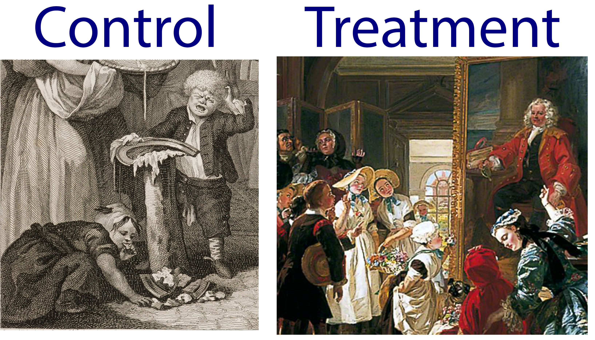
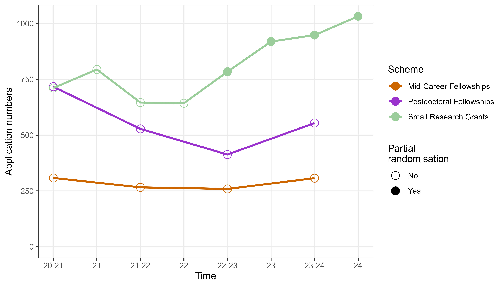
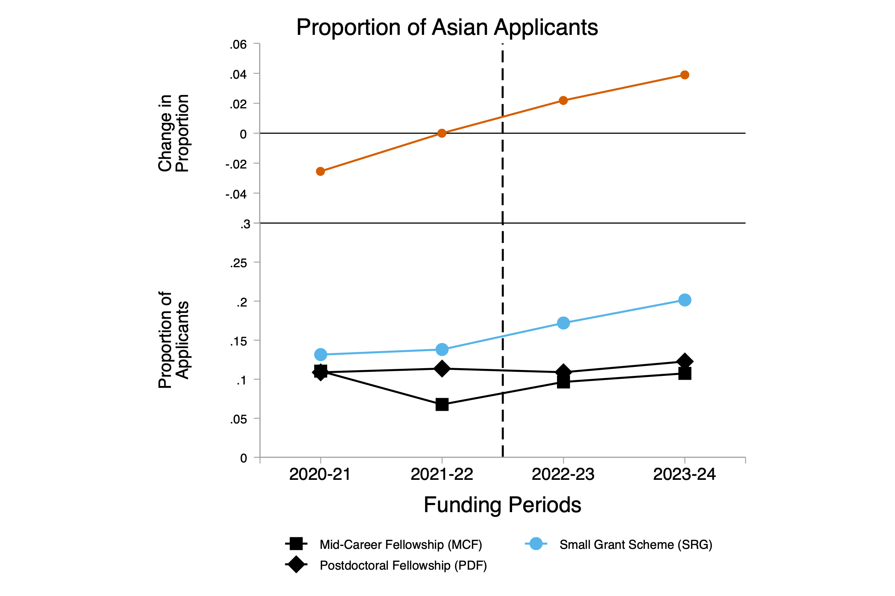
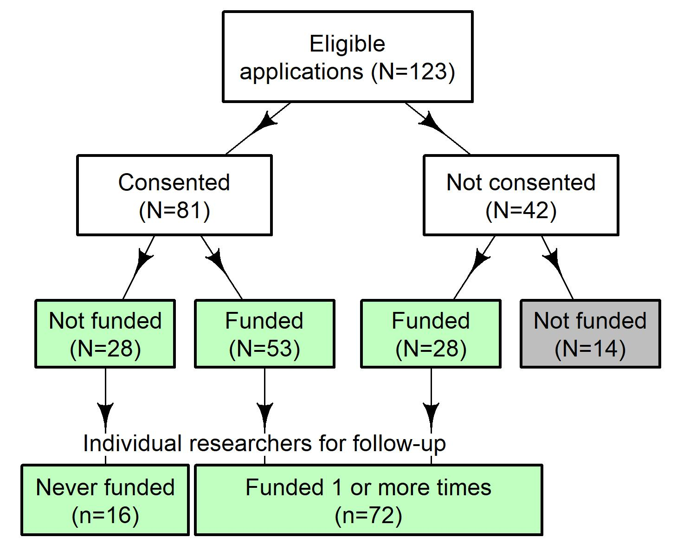
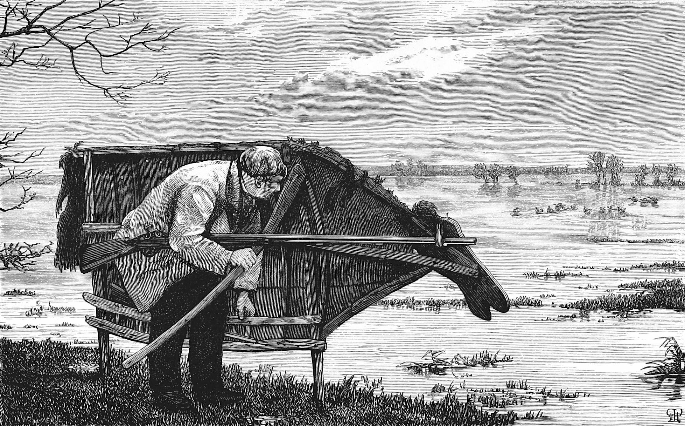
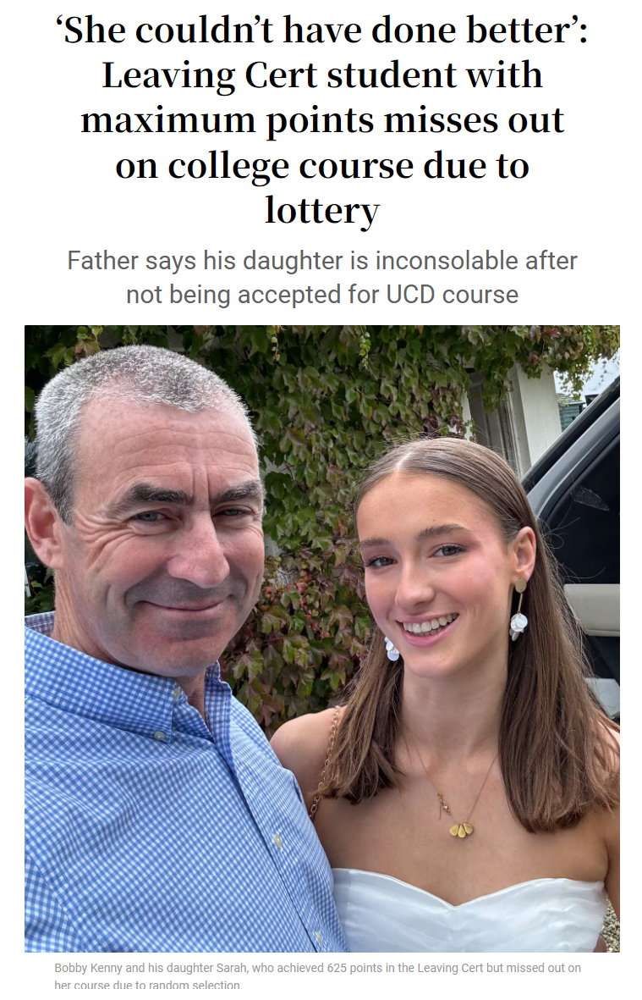
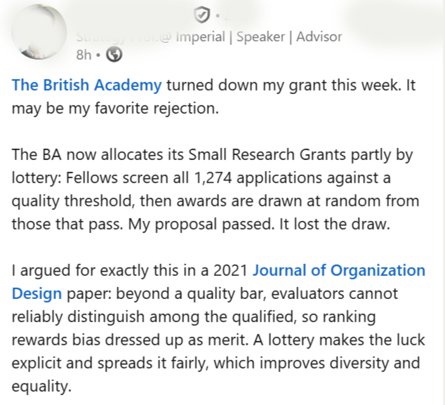

## Outline{background-color='#ffc100'}

<!--- 30-40min presentation --->

:::: columns
::: {.column width="50%"}

* Little bit of history

* Lotteries in:
  + Research funding
  + Health and medicine
:::
  
::: {.column width="50%"}
<iframe src="https://giphy.com/embed/RK9E0eC8LvDmI3QddR" width="480" height="480" style="" frameBorder="0" class="giphy-embed" allowFullScreen></iframe>
:::
::::

::::aside

<a href="https://giphy.com/gifs/man-talking-text-balloon-RK9E0eC8LvDmI3QddR">via GIPHY</a>

::::

## Foundling hospital in London{background-image='figures/foundling_hospital.jpg' background-opacity=0.4 background-size='cover'}

::::aside
[CC BY 4.0](https://creativecommons.org/licenses/by/4.0), via Wikimedia Commons
::::

## Outcomes for foundlings{background-color='white'}

{width=880px}

::::aside

William Hogarth, [Public Domain](https://commons.wikimedia.org/w/index.php?curid=164271733); Edward Matthew Ward - Art UK, [Public Domain](https://commons.wikimedia.org/w/index.php?curid=164271733)

::::

## Why can lotteries inform policy{background-image='figures/clay-banks-kBaf0DwBPbE-unsplash.jpg' background-opacity=0.8 background-size='cover'}

* Confounding is everywhere

* Lotteries remove it all

* Statistical bleach

       
Photo by <a href="https://unsplash.com/@claybanks?utm_content=creditCopyText&utm_medium=referral&utm_source=unsplash">Clay Banks</a> on <a href="https://unsplash.com/photos/blue-and-white-clorox-plastic-bottle-kBaf0DwBPbE?utm_content=creditCopyText&utm_medium=referral&utm_source=unsplash">Unsplash</a>

## Observational disaster{background-color='#585f76'}

:::: columns
::: {.column width="70%"}
* Glucagon-like peptide-1 receptor agonists (GLP-1 RAs) for obesity (e.g., _Ozempic_)

* Observational studies showing that women with breast cancer who take GLP-1 RA's live longer
:::
  
::: {.column width="30%"}
{width=300}
:::
::::

::::aside
Photo by <a href="https://unsplash.com/@sharonmccutcheon?utm_source=unsplash&utm_medium=referral&utm_content=creditCopyText">Alexander Grey</a> on <a href="https://unsplash.com/photos/shallow-focus-photography-of-prescription-bottle-with-capsules-FEPfs43yiPE?utm_source=unsplash&utm_medium=referral&utm_content=creditCopyText">Unsplash</a>
::::

## Observational disaster{background-color='#585f76' visibility="uncounted"}

:::: columns
::: {.column width="70%"}
* But women who took these drugs **had to** live longer (on average) -- immortal time bias
:::
  
::: {.column width="30%"}
{width=300}
:::
::::

::::aside
Photo by <a href="https://unsplash.com/@sharonmccutcheon?utm_source=unsplash&utm_medium=referral&utm_content=creditCopyText">Alexander Grey</a> on <a href="https://unsplash.com/photos/shallow-focus-photography-of-prescription-bottle-with-capsules-FEPfs43yiPE?utm_source=unsplash&utm_medium=referral&utm_content=creditCopyText">Unsplash</a>
::::

# Funders{visibility="uncounted" background-image='figures/mathieu-stern-1zO4O3Z0UJA-unsplash.jpg' background-opacity=0.4 background-size='cover'}

<!-- instead of aside -->
        
Photo by <a href="https://unsplash.com/@mathieustern?utm_source=unsplash&utm_medium=referral&utm_content=creditCopyText">Mathieu Stern</a> on <a href="https://unsplash.com/photos/miniature-person-sitting-on-stack-of-coins-reading-newspaper-1zO4O3Z0UJA?utm_source=unsplash&utm_medium=referral&utm_content=creditCopyText">Unsplash</a>

## Funders that have used lotteries

:::: columns
::: {.column width="50%"}

Health Research Council of New Zealand

VolkswagenStiftung

Austrian Science Fund

Swiss National Science Foundation

Novo Nordisk Fonden

British Academy

UKRI / NERC

Wellcome

Nesta

University of Leeds

:::
  
::: {.column width="50%"}

UMC Utrecht/Ministry of OCW

Carnegie Trust

Statistical Society of Australia

Association for Interdisciplinary Meta-Research and Open Science

International Society for Clinical Biostatistics

NZ Ministry of Business, Innovation & Employment

Dana Foundation

Carnegie Trust

Academy of Social Sciences in Australia

:::
::::

::::aside

Thanks to Tom Stafford for this list

::::

# Lotteries at The British Academy{background-image='figures/BA_building.jpeg' background-opacity=0.7 background-size='cover' background-color='transparent'}

Rhys Llewellyn Thomas (Oxford), Philip Clarke (Oxford) Ken Emond (British Academy)

## <small>BA/Leverhulme Small Research Grants</small>

* Total budget around £1.3 million per round
* Awards £10k for up to 24 months
* Often for pilot studies and small-scale projects

## <small>BA/Leverhulme Small Research Grants</small>{visibility="uncounted"}

* Total budget around £1.3 million per round
* Awards £10k for up to 24 months
* Often for pilot studies and small-scale projects
* High priority in the British Academy's portfolio -- running for over 50 years
* Wide outreach: around 100 institutes represented
* 600 applications per round with around 300 suitable for funding with around 150 awarded

## Why switch to a lottery?

* People “self-disqualifying” under the old system as they were not confident of winning funding and perceived a bias if they were not from an “elite” institution

## Why switch to a lottery?{visibility="uncounted"}

* People “self-disqualifying” under the old system as they were not confident of winning funding and perceived a bias if they were not from an “elite” institution

* Spending time picking apart candidates separated by wafer-thin differences - concerns about efficiency

* Small grants are for innovative and/or first opportunities

## More applications{background-color='white'}

Average of 516 more applicants per round

## Greater diversity{background-color='white'}

<!--- from Rhys --->

{width=640}

Asian and Asian British applicants increased by 4%

## British Academy summary{background-image='figures/reuben-juarez-C4sxVxcXEQg-unsplash.jpg' background-opacity=0.3 background-size='cover'}

* "Very encouraging" outcomes; decided to extend the trial for three more years

* Little negative feedback from applicants and reviewers

* "Playing our part towards a fairer and more inclusive research culture"

<!--- quote from https://blogs.lse.ac.uk/impactofsocialsciences/2025/04/16/how-randomisation-has-changed-the-british-academys-approach-to-research-funding/--->

::::aside
Photo by <a href="https://unsplash.com/@sunnystate?utm_content=creditCopyText&utm_medium=referral&utm_source=unsplash">Reuben Juarez</a> on <a href="https://unsplash.com/photos/to-be-continued-sigange-C4sxVxcXEQg?utm_content=creditCopyText&utm_medium=referral&utm_source=unsplash">Unsplash</a>
::::

# Lottery for New Zealand Health Research Council{background-image='figures/sulthan-auliya-v9FIx0J-KAA-unsplash.jpg' background-opacity=0.35 background-size='cover' visibility="uncounted"}

<!-- instead of aside -->
     

Photo by <a href="https://unsplash.com/@swafie?utm_source=unsplash&utm_medium=referral&utm_content=creditCopyText">Sulthan Auliya</a> on <a href="https://unsplash.com/photos/auckland-skyline-and-harbor-in-new-zealand-v9FIx0J-KAA?utm_source=unsplash&utm_medium=referral&utm_content=creditCopyText">Unsplash</a>

## Design

* Started in 2013

* Researchers with transformative, innovative, exploratory, or unconventional research ideas

* Awarded NZD \$150,000 for up to 2 years

## Design{visibility="uncounted"}

* Started in 2013

* Researchers with transformative, innovative, exploratory, or unconventional research ideas

* Awarded NZD \$150,000 for up to 2 years

* Two criteria: 
  + the research is potentially transformative
  + the proposal is exploratory but viable. 

* Short-listed applications are funded at random until the budget is exhausted

## Survey of applicants

* Randomisation accepted for Explorer Grant with 63% (n = 79) in favour and 25% (n = 32) against

::::aside
[Liu et al](https://researchintegrityjournal.biomedcentral.com/articles/10.1186/s41073-019-0089-z) (2020) "The acceptability of using a lottery to allocate research funding: a survey of applicants"
::::

## Survey of applicants

* Randomisation accepted for Explorer Grant with 63% (n = 79) in favour and 25% (n = 32) against

* Randomisation supported after ineligible applications had been excluded and outstanding applications funded, so that the remaining applications were equal

* Greater support for randomisation amongst those that won funding at random!

::::aside
[Liu et al](https://researchintegrityjournal.biomedcentral.com/articles/10.1186/s41073-019-0089-z) (2020) "The acceptability of using a lottery to allocate research funding: a survey of applicants"
::::

## Trial participants{background-color='white'}

## Trial results{background-color='#00861f'}

:::: columns
::: {.column width="70%"}
* World's first trial of funding

* 88 researchers who were followed for an average of 3.8 years

:::
  
::: {.column width="30%"}
:::
::::

::::aside
DOI: [10.1093/scipol/scae045](https://academic.oup.com/spp/article/51/6/1042/7729313)
::::

## Trial results{background-color='#00861f' visibility="uncounted"}

:::: columns
::: {.column width="70%"}
* World's first trial of funding

* 88 researchers who were followed for an average of 3.8 years

* No differences between funded and not funded for:
  + Publication counts
  + Citations
  + Altmetric
:::
  
::: {.column width="30%"}

:::
::::

::::aside
DOI: [10.1093/scipol/scae045](https://academic.oup.com/spp/article/51/6/1042/7729313); Photo by <a href="https://unsplash.com/@badun?utm_source=unsplash&utm_medium=referral&utm_content=creditCopyText">Anastasiya Badun</a> on <a href="https://unsplash.com/photos/a-persons-hand-holding-a-cell-phone-in-front-of-a-green-background-qdiTkuy-4YM?utm_source=unsplash&utm_medium=referral&utm_content=creditCopyText">Unsplash</a>
::::

## Lottery first{background-color='#dcdcdc'}

:::: columns
::: {.column width="50%"}
* Lottery for right to apply

* Greatly reduces application costs

* Used by funders in Germany and Denmark
:::
  
::: {.column width="50%"}

:::
::::

::::aside
Image from the <a href="//commons.wikimedia.org/wiki/Commons:British_Library/Mechanical_Curator_collection" title="Commons:British Library/Mechanical Curator collection">Mechanical Curator collection</a>
::::

# Doctor lotteries{visibility="uncounted" background-image='figures/anirudh-UVa6OF2XXIc-unsplash.jpg' background-opacity=0.4 background-size='cover'}

<!-- instead of aside -->
      
Photo by <a href="https://unsplash.com/@lanirudhreddy?utm_source=unsplash&utm_medium=referral&utm_content=creditCopyText">Anirudh</a> on <a href="https://unsplash.com/photos/a-pair-of-red-and-blue-surfboards-sitting-next-to-each-other-UVa6OF2XXIc?utm_source=unsplash&utm_medium=referral&utm_content=creditCopyText">Unsplash</a>

## Randomised doctors

:::: columns
::: {.column width="50%"}

{width=360}

{width=360}

:::

::: {.column width="50%"}

{width=420}
:::
::::

::::aside
All images from Wikimedia Commons
::::

## Randomised trial of doctors

* Compared those who were accepted on their first application to all others in Sweden

* Follow-up of families from medical school enrollment to eight years later

::::aside
DOI: [10.1257/app.20200405](https://www.aeaweb.org/articles?id=10.1257/app.20200405)
::::

## Randomised trial of doctors{visibility="uncounted"}

* Compared those who were accepted on their first application to all others in Sweden

* Follow-up of families from medical school enrollment to eight years later

* 45\% decrease in heart attacks

* 27\% increase in blood thinner medications

* 22\% increase in HPV vaccination

::::aside
DOI: [10.1257/app.20200405](https://www.aeaweb.org/articles?id=10.1257/app.20200405)
::::

## Reverse direction{background-image='figures/yumu-HQH-GOZ6K2c-unsplash.jpg' background-opacity=0.3 background-size='cover'}

* For prospective randomised trials, we should know the mechanism in order to get ethical approval

::::aside
Photo by <a href="https://unsplash.com/@cdd20?utm_source=unsplash&utm_medium=referral&utm_content=creditCopyText">愚木混株 Yumu</a> on <a href="https://unsplash.com/photos/a-group-of-red-arrows-on-a-black-surface-HQH-GOZ6K2c?utm_source=unsplash&utm_medium=referral&utm_content=creditCopyText">Unsplash</a>
::::

## Reverse direction{background-image='figures/yumu-HQH-GOZ6K2c-unsplash.jpg' background-opacity=0.3 background-size='cover' visibility="uncounted"}

* For prospective randomised trials, we should know the mechanism in order to get ethical approval

* Can assume the doctor effect is causal, but what is the mechanism? 

::::aside
Photo by <a href="https://unsplash.com/@cdd20?utm_source=unsplash&utm_medium=referral&utm_content=creditCopyText">愚木混株 Yumu</a> on <a href="https://unsplash.com/photos/a-group-of-red-arrows-on-a-black-surface-HQH-GOZ6K2c?utm_source=unsplash&utm_medium=referral&utm_content=creditCopyText">Unsplash</a>
::::

## Reverse direction{background-image='figures/yumu-HQH-GOZ6K2c-unsplash.jpg' background-opacity=0.3 background-size='cover' visibility="uncounted"}

* For prospective randomised trials, we should know the mechanism in order to get ethical approval

* Can assume the doctor is causal, but what is the mechanism? 

* Easy access to qualified advice saves lives

* Potentially larger benefits in lower SES families

::::aside
Photo by <a href="https://unsplash.com/@cdd20?utm_source=unsplash&utm_medium=referral&utm_content=creditCopyText">愚木混株 Yumu</a> on <a href="https://unsplash.com/photos/a-group-of-red-arrows-on-a-black-surface-HQH-GOZ6K2c?utm_source=unsplash&utm_medium=referral&utm_content=creditCopyText">Unsplash</a>
::::

## In Australia

* Places at Australian medical schools are greatly over-subscribed, with 3 to 4 applicants for every place

* Most applicants have excellent grades and CVs with impressive extra-curricular activities

* Few will have yet faced the difficult situations that they will often encounter as a doctor

## Bad publicity{background-color='white'}

{.absolute top="20" right="20"}

:::: aside

From Irish Times, August 2024

::::

## Good publicity{background-color='white'}

  

## Where are we?{background-color='#77726d'}

:::: columns
::: {.column width="60%"}
* Lotteries increase fairness

* They are acceptable to many applicants where it's amongst equally qualified

:::
  
::: {.column width="40%"}
<iframe src="https://giphy.com/embed/w87yLYL7lwDWE" width="480" height="360" style="" frameBorder="0" class="giphy-embed" allowFullScreen></iframe>
:::
::::

::::aside

<a href="https://giphy.com/gifs/turtle-slide-climbing-w87yLYL7lwDWE">via GIPHY</a>

::::

## Where are we?{background-color='#77726d'}

:::: columns
::: {.column width="60%"}
* Lotteries increase fairness

* They are acceptable to many applicants where it's amongst equally qualified

* Ideal design to create causal estimates

* Still a hard sell for some
:::
  
::: {.column width="40%"}
<iframe src="https://giphy.com/embed/w87yLYL7lwDWE" width="480" height="360" style="" frameBorder="0" class="giphy-embed" allowFullScreen></iframe>
:::
::::

::::aside

<a href="https://giphy.com/gifs/turtle-slide-climbing-w87yLYL7lwDWE">via GIPHY</a>

::::
