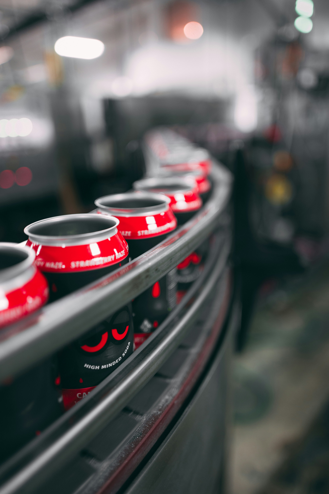
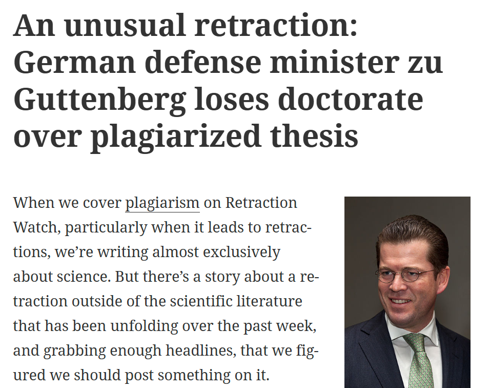
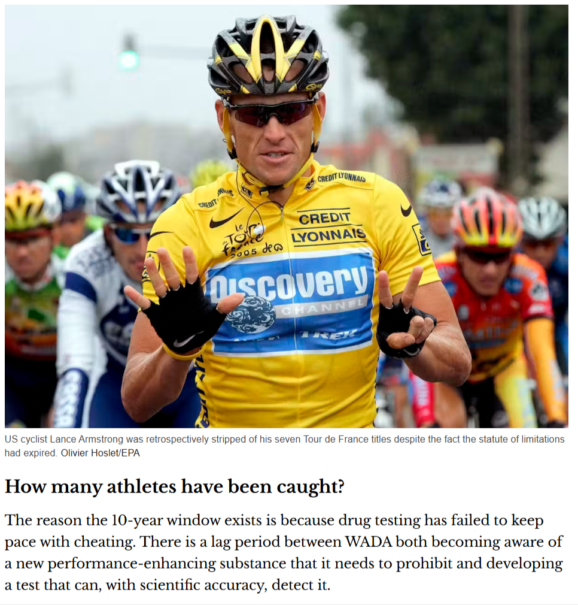
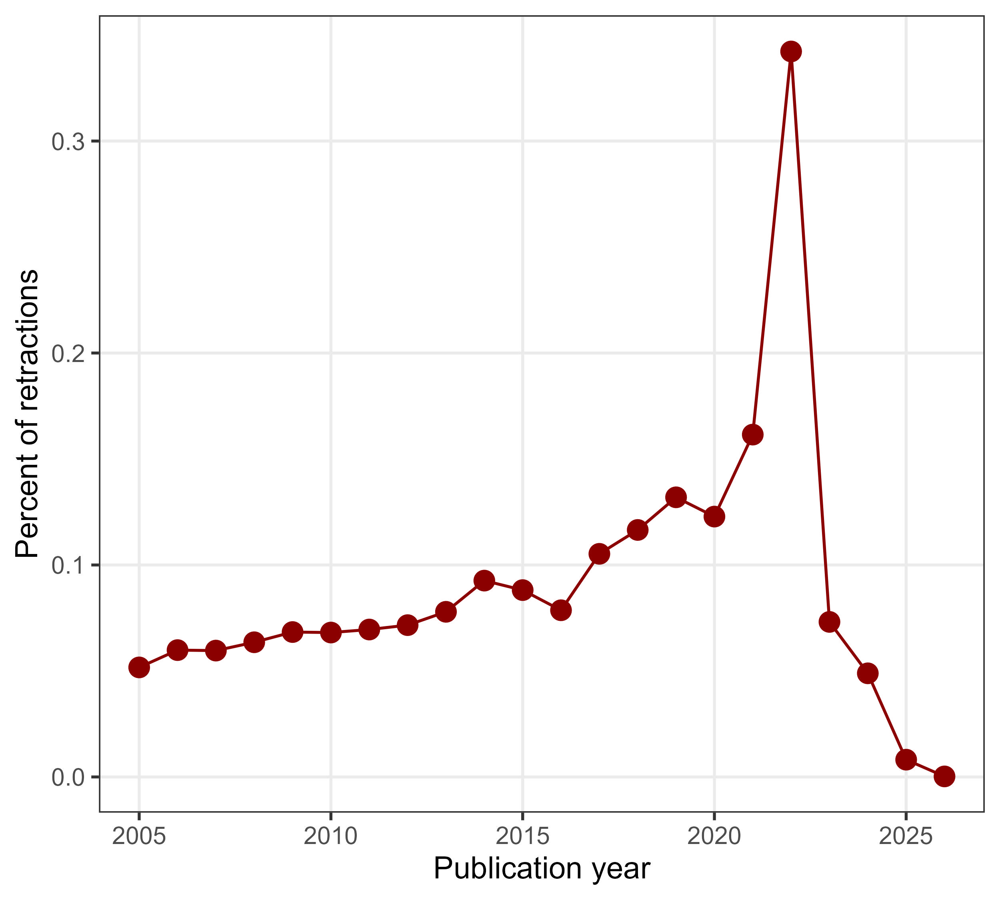
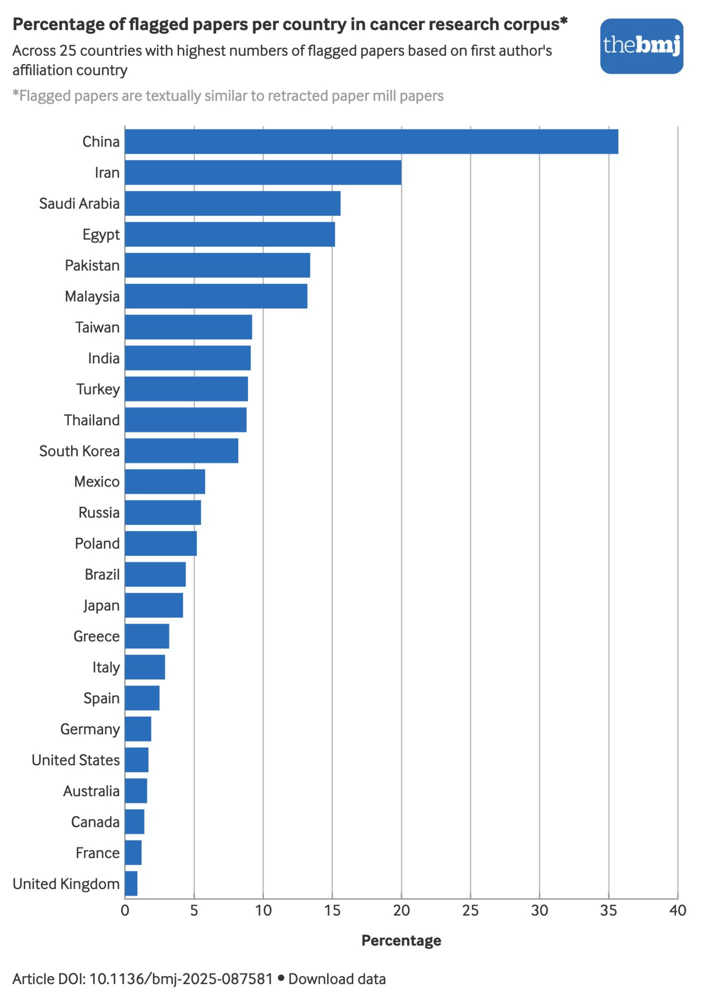
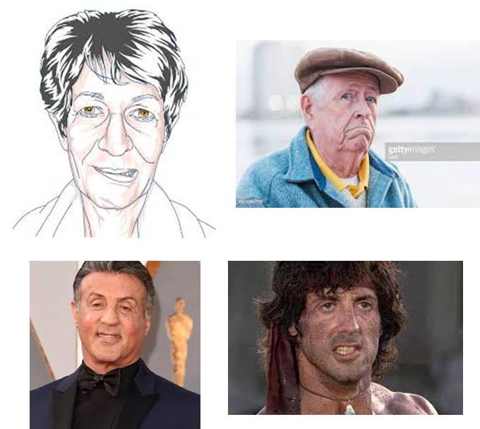
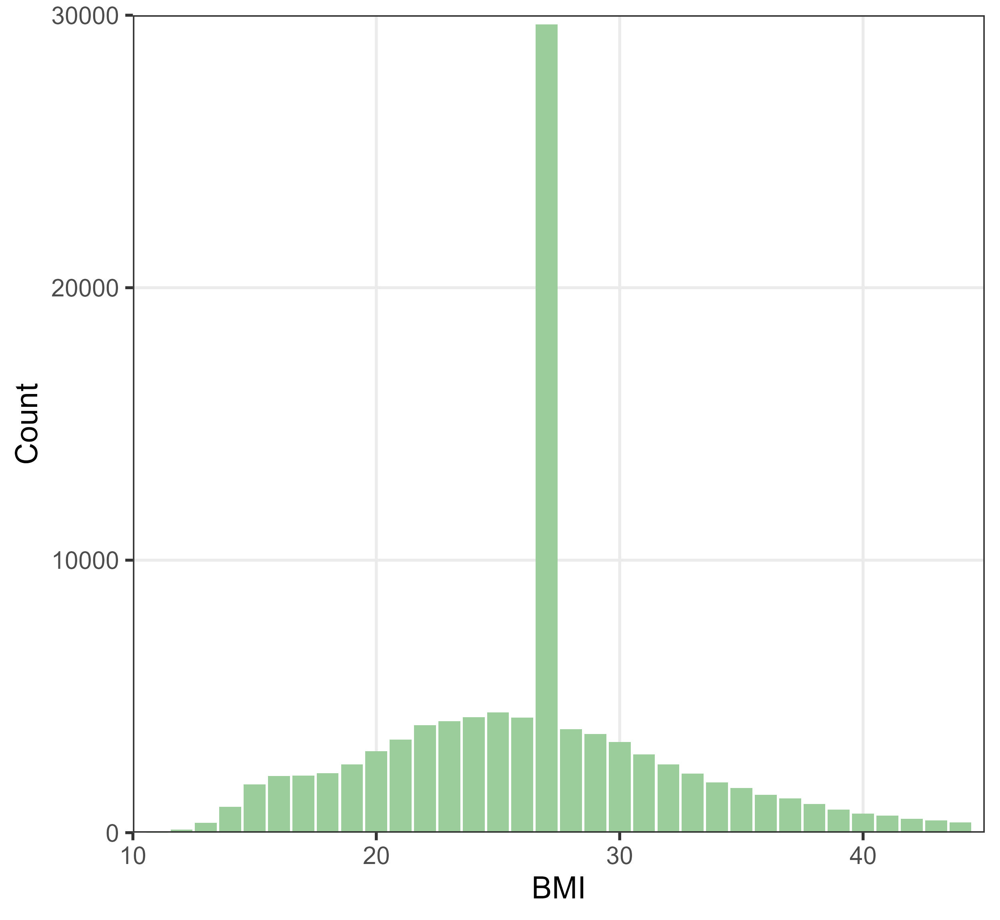
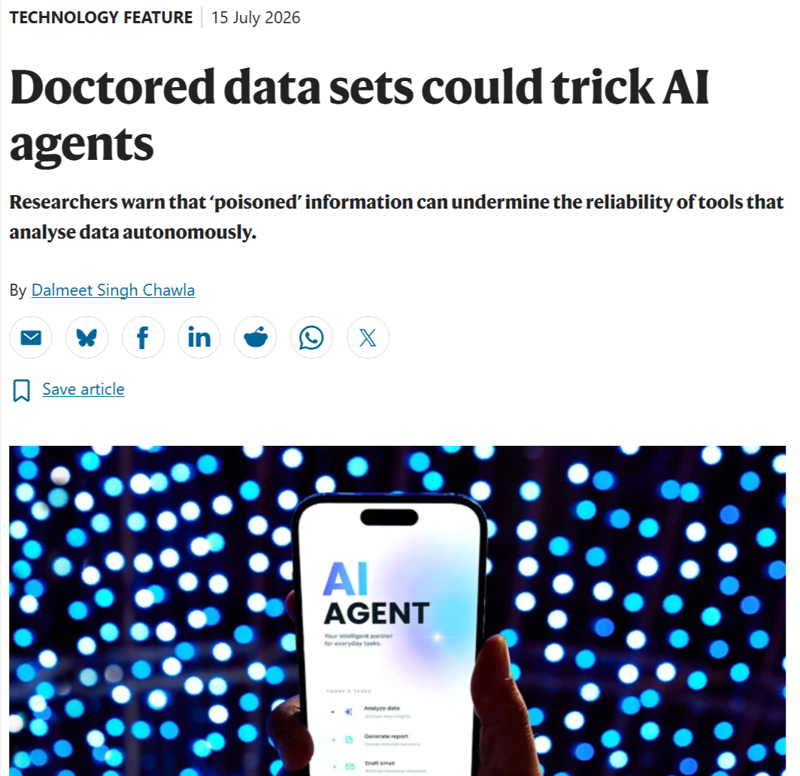

## Slop machines{background-image='figures/antoine-giret-7_TSzqJms4w-unsplash.jpg' background-opacity=0.6 background-size='cover'}

<!--- 30 mins in total, aim for 20 slides --->

::::aside
Photo by <a href="https://unsplash.com/@antoinegiret?utm_source=unsplash&utm_medium=referral&utm_content=creditCopyText">Antoine GIRET</a> on <a href="https://unsplash.com/photos/garbage-near-forest-7_TSzqJms4w?utm_source=unsplash&utm_medium=referral&utm_content=creditCopyText">Unsplash</a>
::::

# Writing cheques {background-image="figures/money-knack-E0sZxhBH8Ck-unsplash.jpg" background-opacity="0.75" background-size="cover"}


<!-- instead of aside -->
<br><br><br><br><br><br><p style="color:black" style="font-size:80%">
Photo by
<a href="https://unsplash.com/@moneyknack?utm_source=unsplash&utm_medium=referral&utm_content=creditCopyText">Money
Knack</a> on
<a href="https://unsplash.com/photos/pen-poised-over-a-check-ready-to-write-E0sZxhBH8Ck?utm_source=unsplash&utm_medium=referral&utm_content=creditCopyText">Unsplash</a></p>


## <xx-small style="color:transparent">Papers for sale</xx-small>{background-image='figures/Authorship-for-sale.png' background-size='contain' background-position='left'}

:::: columns
::: {.column width="60%"}
:::

::: {.column width="40%" style="text-align: right;"}
<br><br><br><br><br><p style="font-size:65%" style="text-align: right;">From author-for-sale.bsky.social</p>
:::
::::

## Price of authorship{background-color='white'}

```{r}
library(dplyr)
library(ggplot2)
price = read.table(header=TRUE, sep=',', text='
Slot,Count,Median,Mean,Min,Max
1,4206,788.41,1031.85,56.87,5631.48
2,4376,675.78,760.88,53.985,5068.33
3,4397,570.00,676.81,47.987,4505.19
4,2995,560.00,636.48,41.99,3378.89
5,1618,420.00,464.47,36.00,1800.00
6,154,462.76,460.67,48.00,1550.00') %>%
  mutate(label = '$')
lplot = ggplot(data = price, aes(x=Slot, y=Median, label=label))+
  geom_line(col='yellow4', linewidth=1.5)+
  geom_point(col='yellow4', size=9)+
  geom_text(col='white', size=8)+
  theme_bw()+
  theme(panel.grid.minor = element_blank(),
        text = element_text(size = 20))+
  xlab('Author position')+
  ylab('Median price (USD)')+
  scale_x_continuous(breaks = 1:6, expand=c(0.02,0.02))+
  scale_y_continuous(limits=c(0,NA))
lplot
```

::::aside
<p style="color:black">DOI: [10.48550/arXiv.2604.24576](https://arxiv.org/html/2604.24576v1)</p>
::::

# Checkered writing{background-image="figures/dagny-reese-tTM1K94ZzhE-unsplash.jpg" background-opacity="0.75" background-size="cover"}

<!-- instead of aside -->
<br><br><br><br><br><br><p style="color:black" style="font-size:80%">
Photo by <a href="https://unsplash.com/@dagny_2020?utm_source=unsplash&utm_medium=referral&utm_content=creditCopyText">Dagny Reese</a> on <a href="https://unsplash.com/photos/red-and-white-checkered-textile-tTM1K94ZzhE?utm_source=unsplash&utm_medium=referral&utm_content=creditCopyText">Unsplash</a>
</p>

## Buyer beware!{background-color='#132121'}

:::: columns
::: {.column width="70%"}
<p style="font-size:80%">MicroRNA-32 inhibits osteosarcoma cell proliferation and invasion by targeting Sox9</p>

<p style="font-size:80%">MicroRNA-153 inhibits osteosarcoma cells proliferation and invasion by targeting TGF-B2</p>

<p style="font-size:80%">MicroRNA-204 inhibits proliferation, migration, invasion and epithelial-mesenchymal transition in osteosarcoma cells via targeting Sirtuin 1</p>
:::
  
::: {.column width="30%"}
{width=390}
:::
::::

::::aside
Photo by <a href="https://unsplash.com/@drinkdrippy?utm_source=unsplash&utm_medium=referral&utm_content=creditCopyText">Drink Drippy</a> on <a href="https://unsplash.com/photos/a-close-up-of-a-stack-of-poker-chips-pNqyWZk2pOQ?utm_source=unsplash&utm_medium=referral&utm_content=creditCopyText">Unsplash</a>
::::

## Thesis fall out{background-color='white'}

{width=610}

::::aside
<p style="color:black">From [Retraction Watch](https://retractionwatch.com/2011/02/25/an-unusual-retraction-german-defense-minister-zu-guttenberg-loses-doctorate-over-plagiarized-thesis/)</p>
::::


## The data will find you{background-color="#a9bdeb"}


::: aside
from dotdave on giphy
:::

## Technology catches up{background-color='white'}

{width=500}

::::aside
<p style="color:black">From Jack Anderson in [The Converation](https://theconversation.com/why-drug-cheats-are-still-being-caught-seven-years-after-the-2012-london-olympics-121123)</p>
::::


# <xx-small style="color:transparent">Oil spill</xx-small> {background-image="figures/alex-albert-p7kl7eTp6dM-unsplash.jpg" background-opacity="0.75" background-size="cover"}

<p style="font-size:200%">

"AI slop is an oil spill in our digital oceans"

</p>

<p style="font-size:120%">

[Katelyn
Chedraoui](https://www.cnet.com/tech/services-and-software/features/ai-slop-is-destroying-the-internet-these-are-the-people-fighting-to-save-it/)

</p>

<!-- instead of aside -->

<br><br><br><br>

<p style="font-size:80%">

Photo by
<a href="https://unsplash.com/@alexalbert?utm_source=unsplash&utm_medium=referral&utm_content=creditCopyText">Alex
Albert</a> on
<a href="https://unsplash.com/photos/a-duck-swimming-in-a-pond-p7kl7eTp6dM?utm_source=unsplash&utm_medium=referral&utm_content=creditCopyText">Unsplash</a>

</p>

<!--- aim for 30 mins, then Q&A --->

## How deep? {background-color="white"}

{width="640px"}

## How much is cleaned up? {background-color="white"}

<!--- https://www.nature.com/articles/d41586-022-02071-6 --->

::::: columns
::: {.column width="60%"}
- Retractions are increasing, but not enough

<!--- from retractions_over_time.R--->

{width="500px"}
:::

::: {.column width="40%"}
{width="300px"}

<small>Ivan Oransky</small>

<small>Image and data from
[RetractionWatch](https://retractionwatch.com/meet-the-retraction-watch-staff/about/)</small>
:::
:::::

## <xx-small style="color:transparent">Where</xx-small> {background-color="white"}

::::: columns
::: {.column width="40%"}
<Large>Where are the spills?</Large>
:::

::: {.column width="62%"}
{.absolute top="10" right="20"}
:::
:::::

## Drill, baby, drill! {background-color="white"}

{width="1400px"}

::: aside
<p style="color:black">DOI:
[10.1016/j.jclinepi.2026.112203](https://www.sciencedirect.com/science/article/pii/S0895435626000788)</p>
:::

## Data too open? {background-image="figures/muhammad-zaqy-al-fattah-Lexcm-6FHRU-unsplash.jpg" background-opacity="0.4" background-size="cover"}

- With Matt Spick (Uni of Surrey), we created a paper using *Prism*
  (*OpenAI*) in 30 minutes with no human input

::: aside
[LSE
Impact](https://blogs.lse.ac.uk/impactofsocialsciences/2026/03/17/research-integrity-is-locked-into-an-arms-race-with-agentic-ai-slop/);
Photo by
<a href="https://unsplash.com/@dizzydizz?utm_source=unsplash&utm_medium=referral&utm_content=creditCopyText">Muhammad
Zaqy Al Fattah</a> on
<a href="https://unsplash.com/photos/silver-padlock-Lexcm-6FHRU?utm_source=unsplash&utm_medium=referral&utm_content=creditCopyText">Unsplash</a>
:::

## Data too open? {visibility="uncounted" background-image="figures/muhammad-zaqy-al-fattah-Lexcm-6FHRU-unsplash.jpg" background-opacity="0.4" background-size="cover"}

- With Matt Spick (Uni of Surrey), we created a paper using *Prism*
  (*OpenAI*) in 30 minutes with no human input

- *Paper Orchestra* (*Google*), produces a submission-ready manuscript
  with figures and verified citations in about 40 minutes

<!--- https://yiwen-song.github.io/paper_orchestra/ --->

::: aside
[LSE
Impact](https://blogs.lse.ac.uk/impactofsocialsciences/2026/03/17/research-integrity-is-locked-into-an-arms-race-with-agentic-ai-slop/);
Photo by
<a href="https://unsplash.com/@dizzydizz?utm_source=unsplash&utm_medium=referral&utm_content=creditCopyText">Muhammad
Zaqy Al Fattah</a> on
<a href="https://unsplash.com/photos/silver-padlock-Lexcm-6FHRU?utm_source=unsplash&utm_medium=referral&utm_content=creditCopyText">Unsplash</a>
:::

## Data slop {background-color="white"}

::::: columns
::: {.column width="50%"}
<p style="font-size:70%">

"A smart camera located in patient rooms has been used to collect
images"

</p>

{width="400"}
:::

::: {.column width="50%"}
:::
:::::

::: aside
<p style="color:black">DOI:[10.1038/s41598-025-28513-5](https://www.nature.com/articles/s41598-025-28513-5)</p>
:::

## Data slop {background-color="white" visibility="uncounted"}

::::: columns
::: {.column width="50%"}
<p style="font-size:70%">

"A smart camera located in patient rooms has been used to collect
images"

</p>

{width="400"}
:::

::: {.column width="50%"}
<p style="font-size:70%">

"An authoritative dataset was used as the research object"

</p>

{width="400"}
:::
:::::

::: aside
<p style="color:black">DOI:[10.1038/s41598-025-28513-5](https://www.nature.com/articles/s41598-025-28513-5) & DOI:[10.1038/d41586-026-00697-4](https://www.nature.com/articles/d41586-026-00697-4)</p>
:::

## Doctored data{background-color='white'}

{width=500}

::::aside
<p style="color:black">DOI: [10.1038/d41586-026-02071-w](https://www.nature.com/articles/d41586-026-02071-w)</p>
::::


# Solutions? {background-color="#d5c3a3"}


::: aside
from giphy
:::

## Researchers leave paper trails {background-color="white"}


::: aside
<p style="color:black">from BoxMedia on giphy</p>
:::

## Take precautations {background-image="figures/charles-betito-filho-ccYgXLar_1I-unsplash.jpg" background-opacity="0.4" background-size="cover"}

ArXiv is now:

- Limiting submissions from computer science

- Banning users for a year if they submit hallucinated references

::: aside
Photo by
<a href="https://unsplash.com/@cbetito?utm_source=unsplash&utm_medium=referral&utm_content=creditCopyText">Charles
Betito Filho</a> on
<a href="https://unsplash.com/photos/a-man-in-a-shiny-silver-suit-with-a-hood-on-ccYgXLar_1I?utm_source=unsplash&utm_medium=referral&utm_content=creditCopyText">Unsplash</a>
:::

## Money for quality control {background-image="figures/adam-nir-wTO6MWpMrJk-unsplash.jpg" background-opacity="0.15" background-size="cover"}

- The *American Society for Quality* states that organisations typically
  spend 10 to 15% of their operating costs on quality-related costs

- For the Australian NHMRC budget only, this would mean \$740 million per year on
  quality-related work

- What we actually spend is around \$1 million

::: aside
Photo by
<a href="https://unsplash.com/@adamnir?utm_source=unsplash&utm_medium=referral&utm_content=creditCopyText">Adam
Nir</a> on
<a href="https://unsplash.com/photos/a-close-up-of-a-one-dollar-bill-wTO6MWpMrJk?utm_source=unsplash&utm_medium=referral&utm_content=creditCopyText">Unsplash</a>
:::

## Money for quality control {visibility="uncounted" background-image="figures/adam-nir-wTO6MWpMrJk-unsplash.jpg" background-opacity="0.15" background-size="cover"}

- The *American Society for Quality* states that organisations typically
  spend 10 to 15% of their operating costs on quality-related costs

- For the Australian NHMRC budget only, this would mean \$740 million per year on
  quality-related work

- What we actually spend is around \$1 million

- Publishers cry poor, but last year the mega-publisher *Elsevier* made GBP £1.2 billion in profit

::: aside
Photo by
<a href="https://unsplash.com/@adamnir?utm_source=unsplash&utm_medium=referral&utm_content=creditCopyText">Adam
Nir</a> on
<a href="https://unsplash.com/photos/a-close-up-of-a-one-dollar-bill-wTO6MWpMrJk?utm_source=unsplash&utm_medium=referral&utm_content=creditCopyText">Unsplash</a>
:::

## <xx-small style="color:transparent">Turn down the heat</xx-small> {background-image="figures/nature_articles.jpg" background-opacity="1" background-color="white" background-size="contain"}

