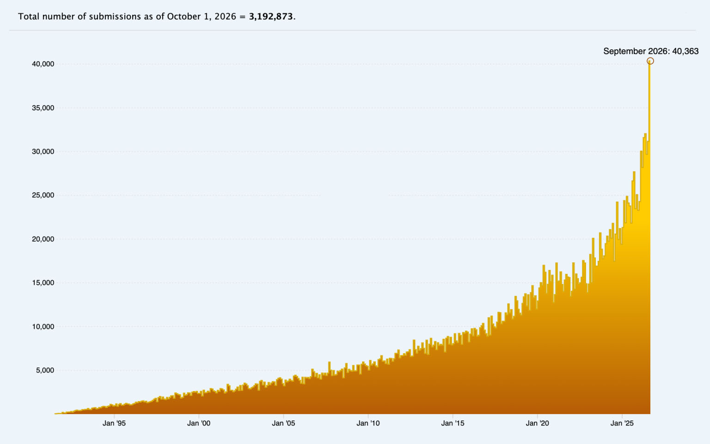
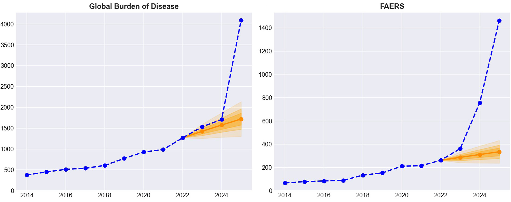
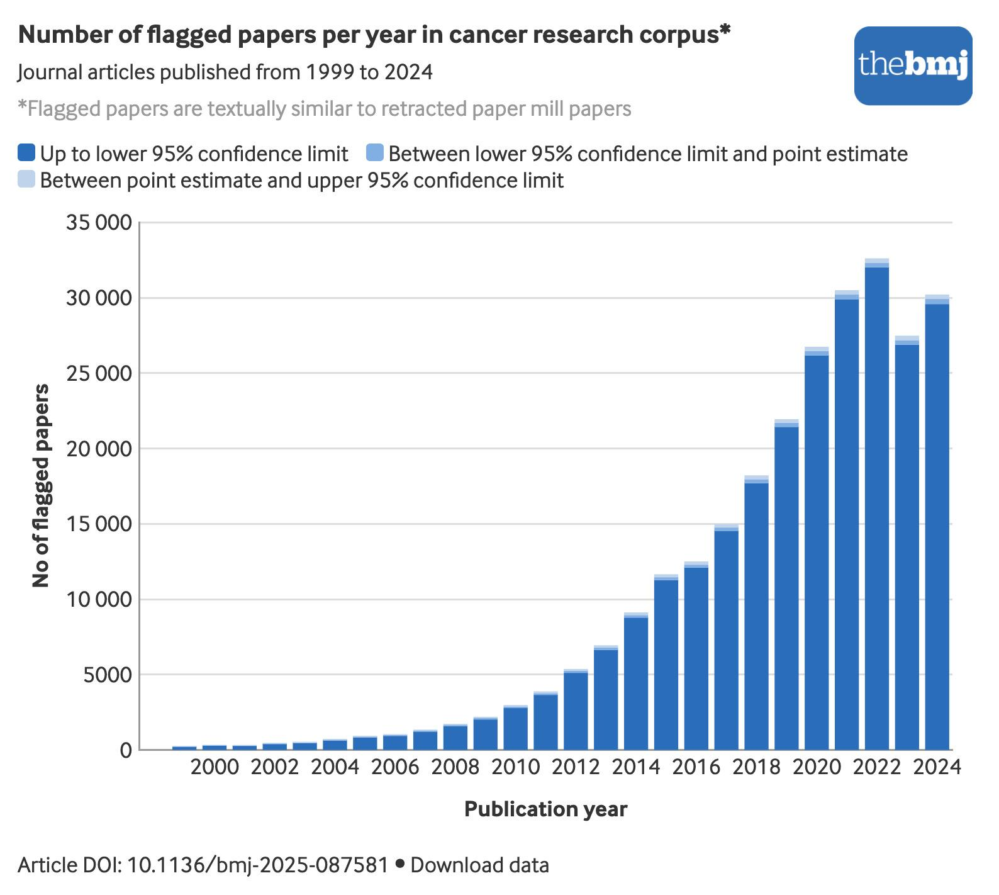

## Publishing under strain{background-color='#edf4fa'}

{width=860}

::::aside

From [ArXiv](https://blog.arxiv.org/2026/10/01/updated-rate-limit-policy/)

::::

## Paper mining{background-color="white"}

{width="1400px"}

::: aside

DOI:
[10.1016/j.jclinepi.2026.112203](https://www.sciencedirect.com/science/article/pii/S0895435626000788)

:::

## Paper mills{background-color="white"}

{width="640px"}

## Peer review under strain

::::aside
Thanks to [Peer-Reviewed Slop](https://bsky.app/profile/peer-reviewed-slop.bsky.social); paper in [Elsevier journal](https://www.sciencedirect.com/science/article/abs/pii/S0010854524002881)
::::

## AI review{background-image='figures/jeffery-ho-pjUyvoq7mUI-unsplash.jpg' background-opacity=0.4 background-size='cover'}

AI is behind many of the problems

Can AI help solve some of them?

::::aside
Photo by <a href="https://unsplash.com/@jefferyho?utm_source=unsplash&utm_medium=referral&utm_content=creditCopyText">Jeffery Ho</a> on <a href="https://unsplash.com/photos/white-red-blue-and-yellow-robot-toy-pjUyvoq7mUI?utm_source=unsplash&utm_medium=referral&utm_content=creditCopyText">Unsplash</a>
::::