## Outline{background-color='#ffc100'}

<!--- have 3 hours --->


:::: columns
::: {.column width="50%"}

* Scale of bad research

* Common bad designs that can be fixed

* Resources

* Questions welcome
:::
  
::: {.column width="50%"}
<iframe src="https://giphy.com/embed/RK9E0eC8LvDmI3QddR" width="480" height="480" style="" frameBorder="0" class="giphy-embed" allowFullScreen></iframe>

:::
::::

::::aside
<p><a href="https://giphy.com/gifs/man-talking-text-balloon-RK9E0eC8LvDmI3QddR">via @darienson on GIPHY</a></p>
::::

## Disclaimer{background-color='#e0e0e0'}

:::: columns
::: {.column width="55%"}
* Surface-level summary of some statistical issues

* Researchers should have a thorough understanding of the statistical methods that they use
:::
  
::: {.column width="45%"}
{width=380}
:::
::::

::::aside
<p style="color:black">Photo by <a href="https://unsplash.com/@jor9en?utm_source=unsplash&utm_medium=referral&utm_content=creditCopyText">Jorgen Hendriksen</a> on <a href="https://unsplash.com/photos/a-blurred-person-is-riding-a-bicycle-BomU_atAAKQ?utm_source=unsplash&utm_medium=referral&utm_content=creditCopyText">Unsplash</a></p>
::::
  

## Disclaimer{background-color='#e0e0e0' visibility='uncounted'}

:::: columns
::: {.column width="55%"}
* Surface-level summary of some statistical issues

* Researchers should have a thorough understanding of the statistical methods that they use

* My opinions based on my 30+ years of experience as a statistician
:::
  
::: {.column width="45%"}
{width=380}
:::
::::

::::aside
<p style="color:black">Photo by <a href="https://unsplash.com/@jor9en?utm_source=unsplash&utm_medium=referral&utm_content=creditCopyText">Jorgen Hendriksen</a> on <a href="https://unsplash.com/photos/a-blurred-person-is-riding-a-bicycle-BomU_atAAKQ?utm_source=unsplash&utm_medium=referral&utm_content=creditCopyText">Unsplash</a></p>
::::
  

# Current problems in health and medical research{background-image='figures/simon-wilkes-S297j2CsdlM-unsplash.jpg' background-opacity=0.4 background-size='cover' visibility="uncounted"}

<!-- instead of aside -->
<br><br><br><br><br><p style="font-size:80%">
Photo by <a href="https://unsplash.com/@simonfromengland?utm_source=unsplash&utm_medium=referral&utm_content=creditCopyText">Simon Wilkes</a> on <a href="https://unsplash.com/photos/green-leafed-tree-surrounded-by-fog-during-daytime-S297j2CsdlM?utm_source=unsplash&utm_medium=referral&utm_content=creditCopyText">Unsplash</a></p>

## Early concerns{background-color='#ddd6cc'}

:::: columns
::: {.column width="60%"}
* 1988: Bland and Altman: “Bad statistics makes bad research, bad research may lead to bad medicine, and bad medicine may cost lives.”

:::
  
::: {.column width="40%"}
{.absolute top="70" right="-20" width="420"}
:::
::::

::::aside
Photo from Oxford Clinical Trials Research Unit
::::

<!--- 1395 citations for scandal paper --->

## Early concerns{background-color='#ddd6cc' visibility="uncounted"}

:::: columns
::: {.column width="60%"}
* 1988: Bland and Altman: “Bad statistics makes bad research, bad research may lead to bad medicine, and bad medicine may cost lives.”

* 1994: Doug Altman wrote about "The scandal of _poor_ medical research" in the _BMJ_

* 2015: Doug: Wish I'd said "bad"
:::
  
::: {.column width="40%"}
{.absolute top="70" right="-20" width="420"}
:::
::::

::::aside
Photo from Oxford Clinical Trials Research Unit
::::


## Research waste

* An estimated 85% of research is wasted because:
  + 50% is not published
  + Over 50% has avoidable design flaws
  + Over 50% is unusable or incompletely reported, or both

::::aside
[Glasziou & Chalmers](https://www.bmj.com/content/363/bmj.k4645) "Research waste is still a scandal" _BMJ_ 2018
::::

## Lancet series on research waste

<p style="font-size:66%">Correctable weaknesses in the design, conduct, and analysis of biomedical and public health research studies can produce misleading results and waste valuable resources. Small effects can be difficult to distinguish from bias introduced by study design and analyses. An absence of detailed written protocols and poor documentation of research is common. Information obtained might not be useful or important, and statistical precision or power is often too low or used in a misleading way. Insufficient consideration might be given to both previous and continuing studies. Arbitrary choice of analyses and an overemphasis on random extremes might affect the reported findings. Several problems relate to the research workforce, including failure to involve experienced statisticians and methodologists, failure to train clinical researchers and laboratory scientists in research methods and design, and the involvement of stakeholders with conflicts of interest. Inadequate emphasis is placed on recording of research decisions and on reproducibility of research. Finally, reward systems incentivise quantity more than quality, and novelty more than reliability.</p>

:::: aside
DOI: [10.1016/S0140-6736(13)62227-8](https://pubmed.ncbi.nlm.nih.gov/24411645/) from 2014
::::


## Significance obsession{background-color='white'}

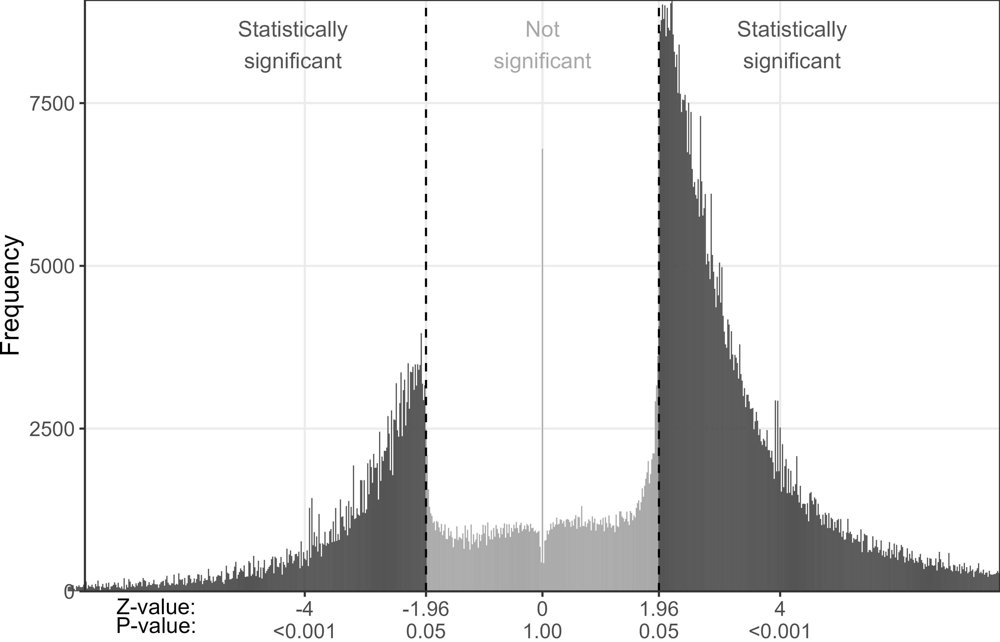{width=780}

::::aside
<p style="color:black">Z-values extracted from confidence intervals in _Medline_ between 1976 and 2019. DOI: [10.1111/stan.12241](https://onlinelibrary.wiley.com/doi/full/10.1111/stan.12241)</p>
::::

## Meta-research studies

* 1,013 out of 1,659 trials were at high risk of bias. Estimated cost of bad trials was £726 million to £8&nbsp;billion. DOI: [10.1186/s13063-022-06415-5](https://trialsjournal.biomedcentral.com/articles/10.1186/s13063-022-06415-5)

:::incremental
* Out of 606 COVID-19 prediction models, only 7 were useful for policy. DOI: [10.1136/bmj.m1328](https://www.bmj.com/content/369/bmj.m1328)

* Only eight of 20 papers on linear regression were computationally reproducible. DOI: [10.64898/2026.04.07.26350286](https://www.medrxiv.org/content/10.64898/2026.04.07.26350286.abstract)
:::

## Paper mining{background-color='white'}

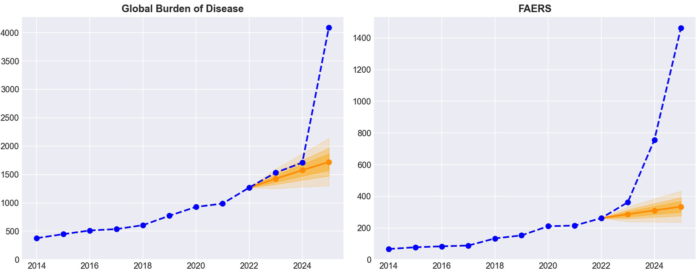

::::aside
<p style="color:black">DOI:
[10.1016/j.jclinepi.2026.112203](https://www.sciencedirect.com/science/article/pii/S0895435626000788)</p>
::::


## Ethics and bad study design

* 2024 change to the Declaration of Helsinki: 
   + "Medical research involving human participants must have a scientifically sound and rigorous design and execution that are likely to produce reliable, valid, and valuable knowledge and avoid research waste."

:::incremental
* Ethics approval is an ideal time to intervene to avoid waste
:::

## National statement

* "Research that has merit is [...] designed or developed using methods appropriate for achieving the aims of the proposal" (Section&nbsp;1.1b)

* "Each institution must ensure that any human research for which it is responsible is designed, reviewed, approved, authorised, conducted and monitored in accordance with the National Statement and the Code" (Section&nbsp;5.1.2)

## Current situation

* Only 35% of Australian HRECs had a qualified statistician as full member or available for consultation (95% CI: 31% to 40%)

::::aside
DOI: [10.1162/QSS.a.479/136239](https://direct.mit.edu/qss/article/doi/10.1162/QSS.a.479/136239)
::::

## Current situation{visibility="uncounted"}

* Only 35% of Australian HRECs had a qualified statistician as full member or available for consultation (95% CI: 31% to 40%)

* Many HRECs do not examine study design
  + <p style="font-size:80%">“It is NOT up to the committee to design the research”</p> 
  + <p style="font-size:80%">Seen as an institutional responsibility to examine study design</p>
  + <p style="font-size:80%">Perceived hierarchy of studies which do and do not require statistical review</p>

::::aside
DOI: [10.1162/QSS.a.479/136239](https://direct.mit.edu/qss/article/doi/10.1162/QSS.a.479/136239)
::::


## Can AI help with study design?{background-color='#fbf8e5' .smaller}

:::: columns
::: {.column width="60%"}
* The internet and literature is full of bad advice on statistics, so AI chatbots may regurgitate these errors 

* AI models provide pleasing answers and have dichotomania. DOIs: [10.1017/jdm.2025.7](https://www.cambridge.org/core/journals/judgment-and-decision-making/article/artificial-intelligence-and-dichotomania/0421D2310727D73FAB47069FD1620AA1); [10.48550/arXiv.2509.08713](https://arxiv.org/abs/2509.08713)

:::
  
::: {.column width="40%"}
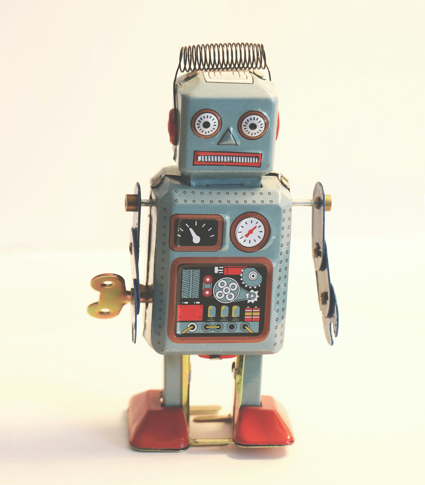
:::
::::

::::aside
<p style="color:black">Photo by <a href="https://unsplash.com/@emilipothese?utm_source=unsplash&utm_medium=referral&utm_content=creditCopyText">Emilipothèse</a> on <a href="https://unsplash.com/photos/gray-and-white-robot-illustration-FTfjMijq-Ws?utm_source=unsplash&utm_medium=referral&utm_content=creditCopyText">Unsplash</a></p>
::::


## Can AI help with study design?{background-color='#fbf8e5' .smaller visibility='uncounted'}

:::: columns
::: {.column width="60%"}
* The internet and literature is full of bad advice on statistics, so AI chatbots may regurgitate these errors 

* AI models provide pleasing answers and have dichotomania. DOIs: [10.1017/jdm.2025.7](https://www.cambridge.org/core/journals/judgment-and-decision-making/article/artificial-intelligence-and-dichotomania/0421D2310727D73FAB47069FD1620AA1); [10.48550/arXiv.2509.08713](https://arxiv.org/abs/2509.08713)

* AI as an addition to human journal peer reviewer is promising

* AI as an additional ethical reviewer?
:::
  
::: {.column width="40%"}

:::
::::

::::aside
<p style="color:black">Photo by <a href="https://unsplash.com/@emilipothese?utm_source=unsplash&utm_medium=referral&utm_content=creditCopyText">Emilipothèse</a> on <a href="https://unsplash.com/photos/gray-and-white-robot-illustration-FTfjMijq-Ws?utm_source=unsplash&utm_medium=referral&utm_content=creditCopyText">Unsplash</a></p>
::::


# Bad designs...{background-image='figures/jon-tyson-od1pKBU7PKA-unsplash.jpg' background-opacity=0.5 background-size='cover'}

... that are fixable

<!-- instead of aside -->
<br><br><br><br><br><br><br><br><p style="font-size:80%">Photo by <a href="https://unsplash.com/@jontyson?utm_source=unsplash&utm_medium=referral&utm_content=creditCopyText">Jon Tyson</a> on <a href="https://unsplash.com/photos/orange-and-white-prescription-bottle-od1pKBU7PKA?utm_source=unsplash&utm_medium=referral&utm_content=creditCopyText">Unsplash</a></p>


## Regression to the mean{background-color='white'} 

:::: columns
::: {.column width="65%"}
* When things are at their best they will often get worse

* When things are at their worst they will often get better

:::
  
::: {.column width="35%"}
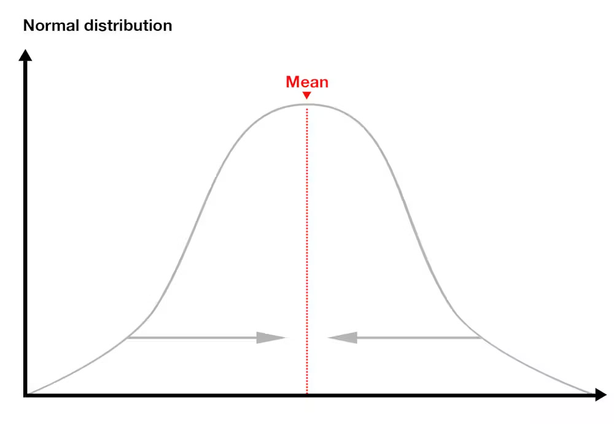{.absolute bottom="100" right="-40" width="420"}

:::
::::

::::aside
[Conversation article](https://theconversation.com/regression-to-the-mean-or-why-perfection-rarely-lasts-74694)
::::


## Regression to the mean{background-color='white' visibility="uncounted"} 

:::: columns
::: {.column width="65%"}
* When things are at their best they will often get worse

* When things are at their worst they will often get better

* This happens because of random chance, not real change

* A bad design can easily make random chance look like real change
:::
  
::: {.column width="35%"}
{.absolute bottom="100" right="-40" width="420"}

:::
::::

::::aside
[Conversation article](https://theconversation.com/regression-to-the-mean-or-why-perfection-rarely-lasts-74694)
::::

## Example study designs
### Regression to the mean

::: incremental
* After a period of unusually high hospital-acquired infections, new hand washing policies are introduced. Infection rates are compared pre- and post-policy change.

* Patients with extreme back pain are referred to a new back program. Patients are measured at baseline and six weeks follow-up.

* Adaptive trials at risk, especially for "non-responders"
:::

<!--- real example on depression if needed --->

## Regression to the mean

* Happens in studies that include time

::: incremental
* Individuals/groups/locations measured before and after some intervention, treatment, policy change, etc

* Can be monthly or weekly statistics, e.g., death counts

* Only occurs if there is measurement error, also known as noise or randomness
  + <p style="font-size:80%">Question: Is there any outcome in health and medicine that does not have some measurement error?</p>
::: 

## Design solutions 
### Regression to the mean

* Add a control group with no intervention
  + Average change from baseline in the control group is then a good estimate of regression to the mean

## Design solutions{visibility="uncounted"} 
### Regression to the mean

* Add a control group with no intervention
  + Average change from baseline in the control group is then a good estimate of regression to the mean

* Add multiple baseline measures per participant
   + Reduce measurement error and hence reduce regression to the mean

## Seasonal changes{background-color='#EEE9BF'}

:::: columns
::: {.column width="50%"}
* Seasonal changes can look like real change

* Many diseases are seasonal

* <p style="font-size:70%">(Figure shows idealised smooth seasonal pattern, real patterns will be noiser)</p>
:::
  
::: {.column width="50%"}
<!--- from plot_season.R --->
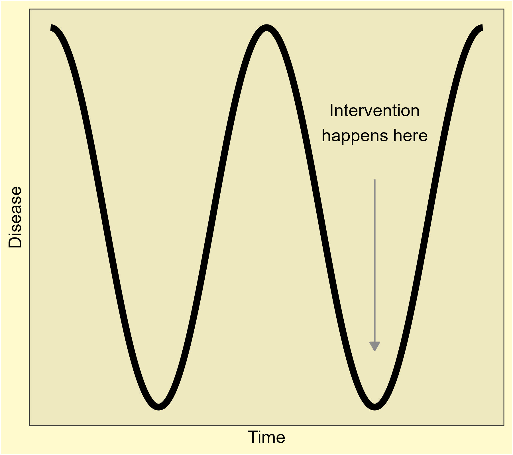
:::
::::


## Regression to the mean{background-color='#476685'}
### Summary

:::: columns
::: {.column width="50%"}
* Common

* Can be a large bias

* Fixable with a control group
:::
  
::: {.column width="50%"}
{.absolute top="50" right="0" width="410"}
:::
::::

::::aside
Photo by <a href="https://unsplash.com/@soymeraki?utm_source=unsplash&utm_medium=referral&utm_content=creditCopyText">Javier Allegue Barros</a> on <a href="https://unsplash.com/photos/silhouette-of-a-road-signage-during-golden-hour-0nOP5iHVaZ8?utm_source=unsplash&utm_medium=referral&utm_content=creditCopyText">Unsplash</a>
::::

## Equivalence{background-color='#A8A8A8'}

:::incremental
* Studies often aim to find a difference, for example, treatment&nbsp;A is better than treatment&nbsp;B

* But finding no difference does not necessarily mean the two treatments are the same

* Absence of evidence is not evidence of absence

* Studies aiming to claim equivalence must use a suitable study design that tests equivalence (or non-inferiority)

* Equivalence studies need much larger sample sizes than difference (superiority) studies
:::

## Reductio ad absurdum{background-color='#A8A8A8'}

:::: columns
::: {.column width="55%"}
* Treatment A: 1 success out of 2&nbsp;patients

* Treatment B: 1 success out of 2&nbsp;patients

* P-value for treatment difference = 1, hence there is no difference, hence the two treatments are the same!
:::

::: {.column width="45%"}
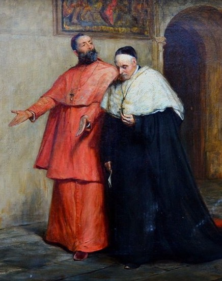{width=400}
:::
::::

::::aside
By [John Pettie](https://commons.wikimedia.org/w/index.php?curid=44945384)  Public Domain
::::

## Equivalence{background-color='#cdbdb0'}

:::: columns
::: {.column width="50%"}
* Equivalance and non-inferiority studies can be extremely useful

* Demonstrate that two treatments have equal efficacy, but one treatment may be cheaper and/or have less side effects
:::
  
::: {.column width="50%"}
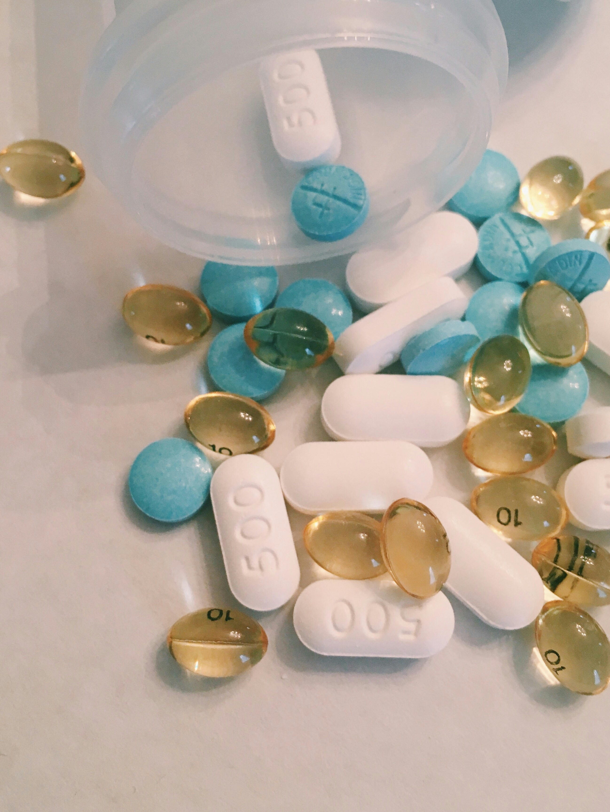{width=400}
:::
::::

::::aside
Photo by <a href="https://unsplash.com/@pinamessina?utm_source=unsplash&utm_medium=referral&utm_content=creditCopyText">pina messina</a> on <a href="https://unsplash.com/photos/assorted-color-medication-pills-kfJkpeI6Lgc?utm_source=unsplash&utm_medium=referral&utm_content=creditCopyText">Unsplash</a>
::::

## Equivalence{background-color='#A8A8A8'}
### Study design

* Define *a priori* what is considered equivalent
  + Example: "A patient and public involvement group predefined the non-inferiority margin as one episode of urinary tract infection per person year." DOI: [10.1136/bmj-2021-0068229](https://pubmed.ncbi.nlm.nih.gov/35264408)

## Equivalence{background-color='#A8A8A8' visibility="uncounted"}
### Study design

* Define *a priori* what is considered equivalent
  + Example: "A patient and public involvement group predefined the non-inferiority margin as one episode of urinary tract infection per person year." DOI: [10.1136/bmj-2021-0068229](https://pubmed.ncbi.nlm.nih.gov/35264408)
  + Consider the efficacy of two drugs as equivalent if difference in the percentage cured is no more than 10%

## Equivalence{background-color='#A8A8A8'}
### Importance of confidence intervals

<!--- from plot_equivalence.R --->

:::: columns
::: {.column width="42%"}
* Example plot shows the mean treatment difference (dot) and 95% confidence interval (horizontal line)

* Equivalence here is a treatment difference within 10%
:::
  
::: {.column width="58%"}
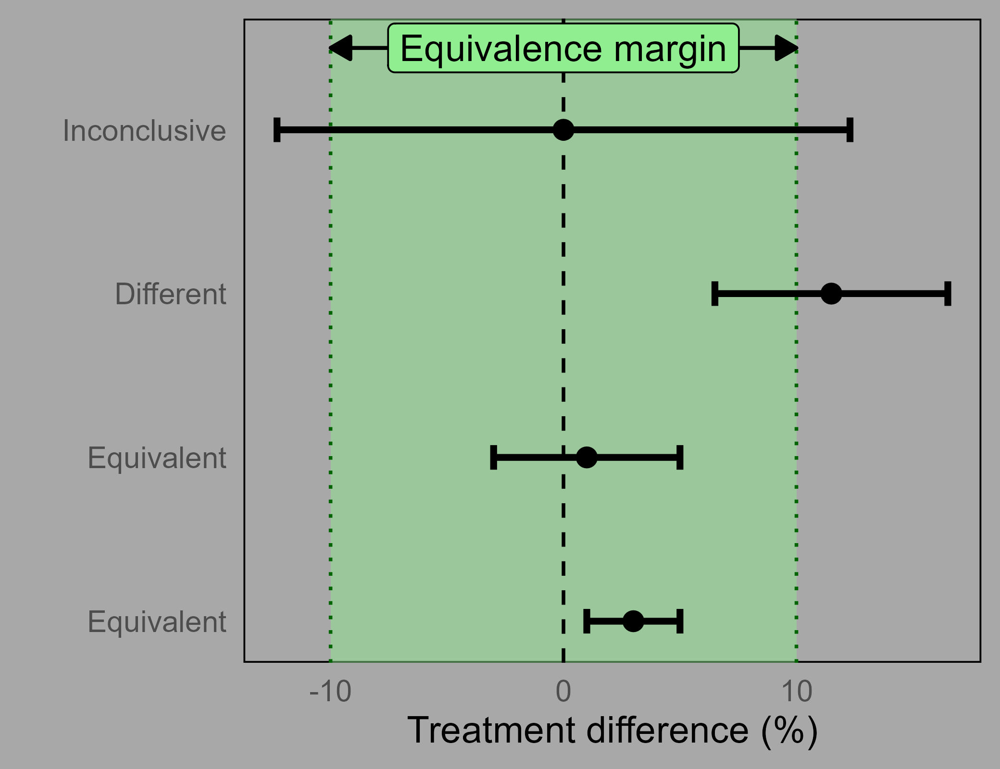
:::
::::

## Equivalence{.smaller background-color='white'}

:::: columns
::: {.column width="50%"}
* 76% to 85% of psychology articles that discussed a non-significant finding misinterpreted non-significance as reflecting no effect. DOI: [10.1098/rsos.242167](https://doi.org/10.1098/rsos.242167)

* In a sample of 498 press releases, 7% wrongly interpreted a non-significant difference as demonstrating equivalence. DOI: [10.1371/journal.pmed.1001308](https://journals.plos.org/plosmedicine/article?id=10.1371/journal.pmed.1001308)
:::
  
::: {.column width="50%"}
{width=380 .absolute top='10' right='0'}
:::
::::

::::aside
<p style="color:black">Photo by <a href="https://unsplash.com/@rishabhben?utm_source=unsplash&utm_medium=referral&utm_content=creditCopyText">Rishabh Sharma</a> on <a href="https://unsplash.com/photos/newspaper-article-lot-R-js25Pv1LQ?utm_source=unsplash&utm_medium=referral&utm_content=creditCopyText">Unsplash</a></p>
::::

## Equivalence{background-color='#476685'}
### Summary

:::: columns
::: {.column width="50%"}
* Common

* Wrongly claiming no difference can misinform policy and practice

* Fixable with more planning and larger sample sizes
:::
  
::: {.column width="50%"}
{.absolute top="50" right="0" width="410"}
:::
::::

::::aside
Photo by <a href="https://unsplash.com/@soymeraki?utm_source=unsplash&utm_medium=referral&utm_content=creditCopyText">Javier Allegue Barros</a> on <a href="https://unsplash.com/photos/silhouette-of-a-road-signage-during-golden-hour-0nOP5iHVaZ8?utm_source=unsplash&utm_medium=referral&utm_content=creditCopyText">Unsplash</a>
::::


## Dichotomania{.smaller}

* Categorise continuous data, e.g., continuous blood pressure categorised to low versus high

:::incremental
* Common problem in health and medical research

* "Inefficient at best and misleading and arbitrary at worst", [Frank Harrell](https://www.fharrell.com/post/errmed/#catg)

* "The stupidity, the criminal vandalism, the wanton destruction of information involved in dichotomisation", [Stephen Senn](https://statmodeling.stat.columbia.edu/2026/02/14/the-stupidity-the-criminal-vandalism-the-wanton-destruction-of-information-involved-in-dichotomisation/)

* Also happens in changes, e.g., response defined as an increase from baseline of at least 10&nbsp;mmHg
:::

## Dichotomania{background-color='white'}
### Discarding information

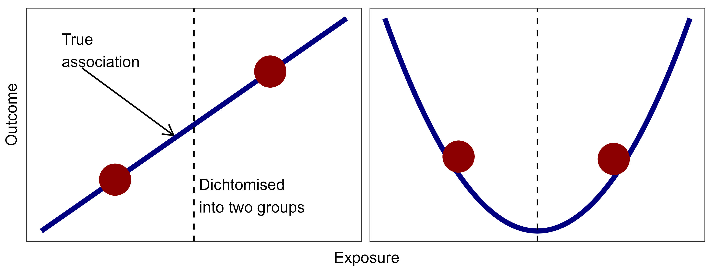

* Arbitrary, inefficient and potentially misleading


## Dichotomania
### Malnutrition example


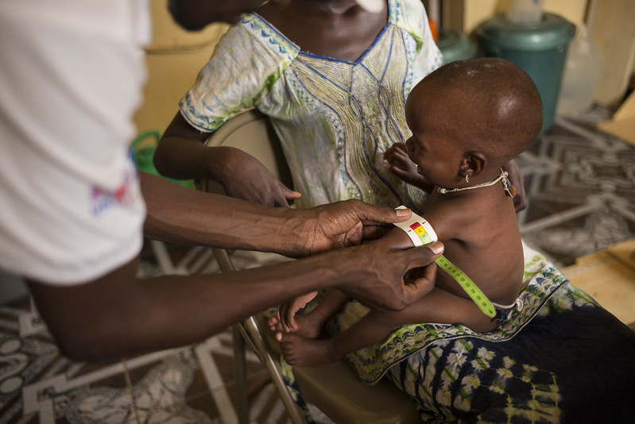{width=600}

::::aside
Image from [Sylvain Cherkaoui](https://www.flickr.com/photos/eu_echo/22568901058/in/photostream/), 
EU Civil Protection and Humanitarian Aid on Flickr [CC BY-ND 2.0](https://creativecommons.org/licenses/by-nd/2.0/deed.en)
::::


## Dichotomania{background-color='white'}

:::incremental
* "Only about 60% of the information is retained after dichotomization" (based on over 21,000 trials)

* Example using [this web page](https://vanzwet.shinyapps.io/info_loss/): 
  + <p style="font-size:70%">Testing group 1 = 30% and group 2 = 40%, the sample size required to have 80% power is 712 (356 per group) (alpha = 0.05, two-sided)</p>
  + <p style="font-size:70%">If the outcome were kept as continuous this would require 430 (215 per group); 282 more participants because of a design choice</p>
  
* "Burdening more participants than necessary is wasteful, costly, and unethical"
:::

::::aside
<p style="color:black">DOI: [10.1002/sim.70402](https://onlinelibrary.wiley.com/doi/full/10.1002/sim.70402)</p>
::::

## Dichotomania
### Unacceptable excuses to dichotomise:

* "A binary design is standard in our field"

* "We used a clinically meaningful cut-off"

* "We used a continuous outcome as a secondary analysis"

## Dichotomania
### Fixes

:::: columns
::: {.column width="68%"}
* Do not discard collected information

* Use statistical models for continuous outcomes, e.g.
  + linear regression instead of logistic regression
  + t-test instead of chi-squared
:::
  
::: {.column width="32%"}
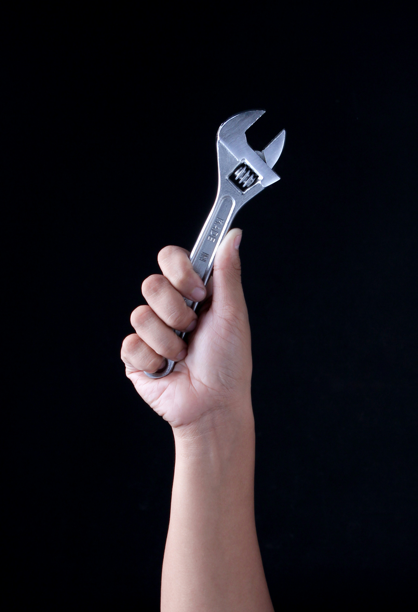{.background .absolute top="50" right="0" width="410"}
:::
::::

::::aside
Photo by <a href="https://unsplash.com/@rechaoktaviani?utm_source=unsplash&utm_medium=referral&utm_content=creditCopyText">Recha Oktaviani</a> on <a href="https://unsplash.com/photos/person-holding-gray-and-black-metal-tool-5tYUk7sZzqc?utm_source=unsplash&utm_medium=referral&utm_content=creditCopyText">Unsplash</a>
::::

## Dichotomania{background-color='#476685'}
### Summary

:::: columns
::: {.column width="50%"}
* Common

* Reduces a study's value

* Unnecessarily increases the number of participants

* Fixable
:::
  
::: {.column width="50%"}
{.absolute top="50" right="0" width="410"}
:::
::::

::::aside
Photo by <a href="https://unsplash.com/@soymeraki?utm_source=unsplash&utm_medium=referral&utm_content=creditCopyText">Javier Allegue Barros</a> on <a href="https://unsplash.com/photos/silhouette-of-a-road-signage-during-golden-hour-0nOP5iHVaZ8?utm_source=unsplash&utm_medium=referral&utm_content=creditCopyText">Unsplash</a>
::::


## Survival data ...{background-color='#B8B8B8'}
### ... needs survival analysis

* Any time-to-event data needs a time-to-event analysis

* For example, time from surgery to readmission to hospital

* Can also have censoring, e.g., those people who were never readmitted to hospital during the study period

:::incremental

* Common error to use logistic regression, e.g., binary outcome of readmission (yes/no)

* Related to dichotomania (discarding information)
:::

## Survival data{background-color='#B8B8B8'}

:::: columns
::: {.column width="52%"}

* Using logistic regression the two groups appear equal

* Using survival analysis group&nbsp;2 is clearly better

* (Made-up data)
:::
  
::: {.column width="48%"}
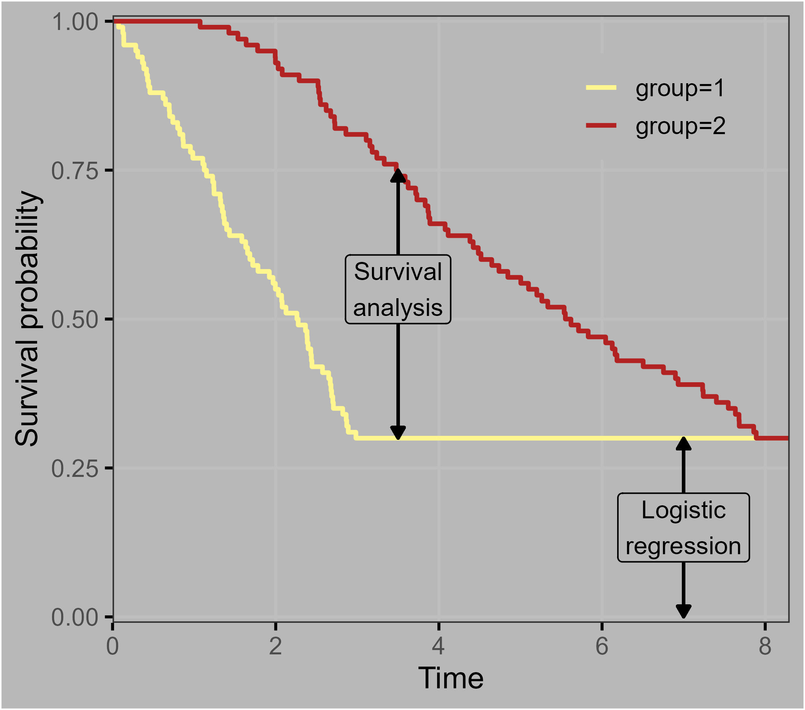
:::
::::

<!--- from plot_curves.R --->

## Immortal time bias

* Occurs in studies that follow people over time

:::incremental
* Study design accidentally creates a period of time when people are "immortal"

* Can be difficult to spot as flawed study designs can appear intuitive

* Studies involving long time periods are always more complicated 
:::

## Immortal time bias
### Recent example

* Breast cancer patients taking glucagon-like peptide-1 receptor agonists (GLP-1 RAs) had a large reduction in mortality compared with control patients (no meds)

* Patients in treatment group had to have 2+ GLP-1 RA prescriptions, creating immortal time

::::aside
DOI: [10.1001/jamanetworkopen.2026.12133](https://jamanetwork.com/journals/jamanetworkopen/fullarticle/2848788)
::::

## <small style="color:transparent">Instagram</small>{background-image='figures/instagram-glp1.png' background-opacity=0.6 background-size='cover'}

## Immortal time{background-color='#e1ded9'}
### My favourite example

:::: columns
::: {.column width="50%"}
* Story: Men who remarry live longer

* Truth: Dead men can't remarry
:::
  
::: {.column width="50%"}
{.absolute top="20" right="0" width="410"}
:::
::::

::::aside
Photo by <a href="https://unsplash.com/@narissa_dv225?utm_source=unsplash&utm_medium=referral&utm_content=creditCopyText">Narissa de Villiers</a> on <a href="https://unsplash.com/photos/a-close-up-of-two-people-holding-hands-WmtpJcAPMco?utm_source=unsplash&utm_medium=referral&utm_content=creditCopyText">Unsplash</a>
::::


## Immortal time bias{background-color='#FFB5C5'}
### Group assignment depends on treatment

<!--- from plot_immortal.R --->

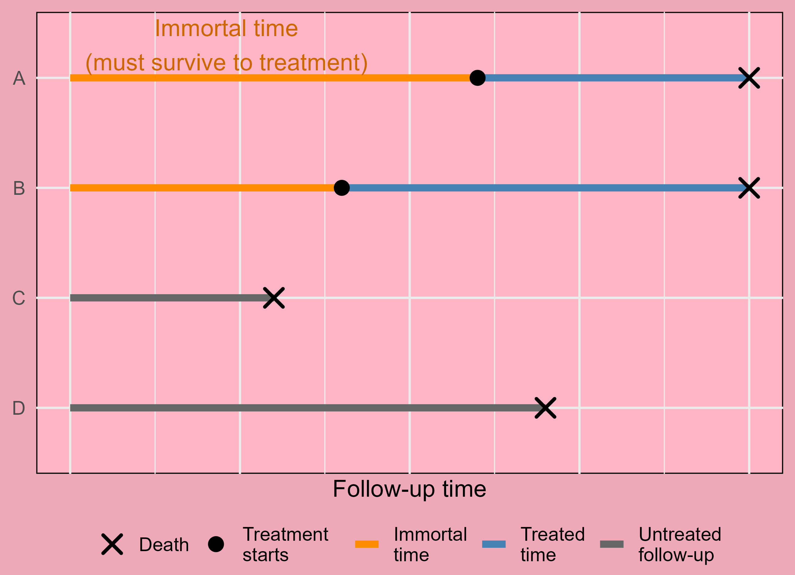{width=770}


## Immortal time

* More often happens in routinely collected data, e.g., data linkage of hospital and PBS data

:::incremental
* Dangerous to look backwards in time using observed data

* Don't see the people who died or exited early

* Think about a prospective study, who would have been lost to follow-up? 

:::


## Immortal time
### Fixes

:::: columns
::: {.column width="59%"}
* <p style="font-size:80%">Never condition on the future</p>

* <p style="font-size:80%">State-space model combined with survival analysis that allows people to move between states (advanced statistical method)</p>

* <p style="font-size:80%">Active instead of non-active controls, e.g., statin&nbsp;A vs statin&nbsp;B instead of statin&nbsp;A vs no treatment </p>
:::
  
::: {.column width="41%"}
{.absolute top="50" right="0" width="410"}
:::
::::

::::aside
Photo by <a href="https://unsplash.com/@rechaoktaviani?utm_source=unsplash&utm_medium=referral&utm_content=creditCopyText">Recha Oktaviani</a> on <a href="https://unsplash.com/photos/person-holding-gray-and-black-metal-tool-5tYUk7sZzqc?utm_source=unsplash&utm_medium=referral&utm_content=creditCopyText">Unsplash</a>
::::

## Immortal time
### Fix (requires all important dates)

<!--- from plot_states.R --->

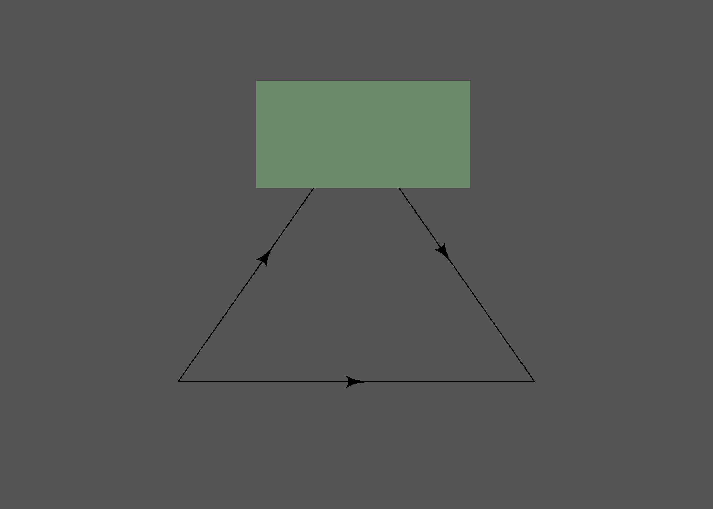


## Immortal time bias{background-color='#476685'}
### Summary

:::: columns
::: {.column width="50%"}
* Not uncommon

* Can cause a very large bias

* Fixable but requires advanced methods and lots of thinking
:::
  
::: {.column width="50%"}
{.absolute top="50" right="0" width="410"}
:::
::::

::::aside
Photo by <a href="https://unsplash.com/@soymeraki?utm_source=unsplash&utm_medium=referral&utm_content=creditCopyText">Javier Allegue Barros</a> on <a href="https://unsplash.com/photos/silhouette-of-a-road-signage-during-golden-hour-0nOP5iHVaZ8?utm_source=unsplash&utm_medium=referral&utm_content=creditCopyText">Unsplash</a>
::::

## Sample size{background-color="#228B22"}

* How many people/participants/patients do we need to answer our research question?

:::incremental
* Key assumptions (for a two-group comparison):
  + Difference between groups
  + Standard deviation (variance) in outcome
  + Significance level (avoid type&nbsp;1 errors), often 5\%
  + Statistical power (avoid type&nbsp;2 errors), often 80\%
:::

## Sample size{background-color='#e2ffe3'}

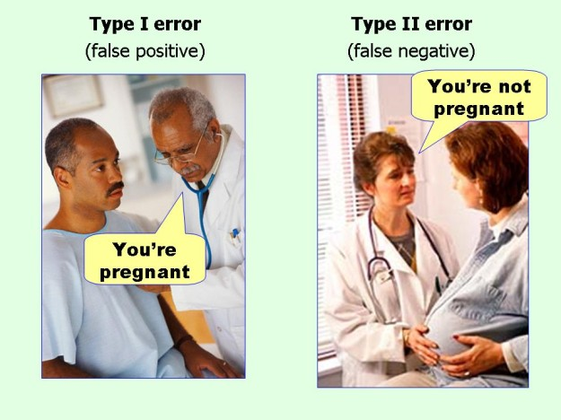{width=550}

* Usually set at 5% type I and 20% for type 2 (often dogmatic)

## {background-color='#968c96'} 

:::: columns
::: {.column width="70%"}

* Sample size must be:
  + Sufficiently large to have reasonable chance of answering the
research question
  + Reduce risks and costs:
    - Money
    - Delayed decision
    - Participant time
    - Researcher time
:::

::: {.column width="30%"}
{.absolute top='30'}
:::
::::

::::aside
Photo by <a href="https://unsplash.com/@miracleday?utm_source=unsplash&utm_medium=referral&utm_content=creditCopyText">Elena Mozhvilo</a> on <a href="https://unsplash.com/photos/small-gold-balance-scale-on-colorful-wood-j06gLuKK0GM?utm_source=unsplash&utm_medium=referral&utm_content=creditCopyText">Unsplash</a>
::::

## Sample size{background-color="#228B22"}
### Example

:::incremental
* Randomised controlled trial of adding an AI reviewer to human review at a journal

* With 334 articles per group, the trial will have a 90% power to detect a reduction in articles with a fundamental flaw from 25% to 15% (5% type I error)

* 95% power requires 413 per group (79 more per group)

* 20% vs 25% difference requires 1464 per group (90% power)
:::

```{r include=FALSE}
library(stats)
d1 = power.prop.test(
  n = NULL,
  p1 = 0.25, # baseline error rate
  p2 = 0.15, # improvement
  sig.level = 0.05,
  power = 0.90,
  alternative = "two.sided"
)
d2 = power.prop.test(
  n = NULL,
  p1 = 0.25, # baseline error rate
  p2 = 0.15, # improvement
  sig.level = 0.05,
  power = 0.95,
  alternative = "two.sided"
)
d3 = power.prop.test(
  n = NULL,
  p1 = 0.25, # baseline error rate
  p2 = 0.20, # improvement
  sig.level = 0.05,
  power = 0.90,
  alternative = "two.sided"
)
```

## Sample size{background-color="#228B22"}
### Catch-22

* Studies that are very similar to previous studies can estimate all unknowns easily, but these are the most derivative

* Truly novel studies can struggle to justify sample sizes, but these are likely to be the most valuable

## Sample size{background-color="#228B22"}

:::incremental
* Every sample size calculation is a compromise

* The calculations assume a meaningful boundary between adequate and inadequate sample sizes that does not exist

* Rarely reflect how a completed study's information will be used

*  “One size fits all” numbers. Sample sizes of 400 for small effects, 64 for medium, and 25 for large
:::

::::aside
DOIs: [10.1186/1741-7015-8-17](https://link.springer.com/article/10.1186/1741-7015-8-17) & [10.1136/bmj.e5278](https://www.bmj.com/content/345/bmj.e5278.long)
::::


## {background-color='white'}

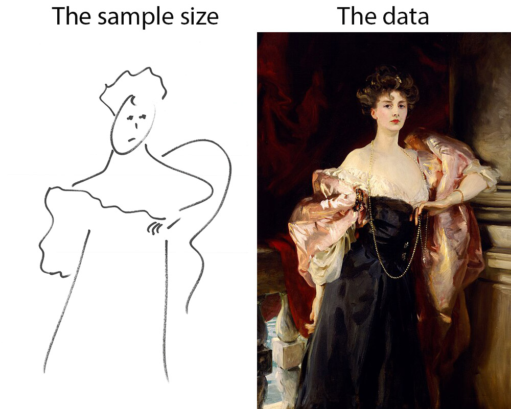{width=690}

::::aside
<p style="color:black">[Lady Helen Vincent](https://commons.wikimedia.org/wiki/File:Sargent_Portrait_of_Lady_Helen_Vincent_1904.jpg) by John Singer Sargent, Public domain, via Wikimedia Commons</p>
::::

## Sample size{background-color="#228B22"}

* Sample size calculation based on a simple comparison (e.g., comparing two means), but the study design is more complex, for example:
  + Multiple follow-up observations
  + Participant drop-out
  + Within-person correlation
  + Geographical clustering
  
* Can use simulation in these cases, requires consultation with a statistician  

## Sample size{background-color="#476685"}
### Summary

:::: columns
::: {.column width="50%"}
* Relies on guesswork

* Aim for the most informed and transparent guess
:::
  
::: {.column width="50%"}
{.absolute top="50" right="0" width="410"}
:::
::::

::::aside
Photo by <a href="https://unsplash.com/@soymeraki?utm_source=unsplash&utm_medium=referral&utm_content=creditCopyText">Javier Allegue Barros</a> on <a href="https://unsplash.com/photos/silhouette-of-a-road-signage-during-golden-hour-0nOP5iHVaZ8?utm_source=unsplash&utm_medium=referral&utm_content=creditCopyText">Unsplash</a>
::::

## Blinding

* Used in research for over 200 years

<!--- https://muse.jhu.edu/article/4142 --->

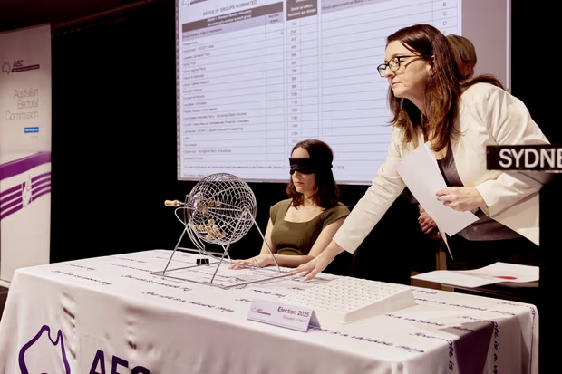

:::: aside
Picture from _The Guardian_ from the 2025 Australian election
::::

## Collect subjective data blind{background-color='#dadbdd'}

{width=720px}

:::: aside
<p style="color:black">From Crispin Porter + Bogusky on [Wikimedia Commons](https://commons.wikimedia.org/wiki/File:Blind_taste_test.jpg)</p>
::::

## Blinding
### Whenever possible...

* Keep participants and researchers blind to treatment

* Collect data blind to treatment, especially key outcomes

* Analyse data blind to treatment

* Report initial results blind to treatment

## Blinding

:::incremental
* Animal studies that did not use randomisation and blinding were far more likely to have a positive result, odds ratio = 5.2 (95% CI: 2.0 to 13.5)

* Many researchers appear unaware of the importance of blinding

* "If I was king of the world [...] I would insist that
every experiment was performed blinded." [Dr Glen Begley](https://www.youtube.com/watch?v=YJADzllTM9w)
:::

:::: aside
DOI: [10.1111/j.1553-2712.2003.tb00056.x](https://onlinelibrary.wiley.com/doi/10.1111/j.1553-2712.2003.tb00056.x)
::::


## Randomising{background-image='figures/clay-banks-kBaf0DwBPbE-unsplash.jpg' background-opacity=0.8 background-size='cover'}

Statistical bleach

<br><br><br><br><p style="font-size:80%">Photo by <a href="https://unsplash.com/@claybanks?utm_content=creditCopyText&utm_medium=referral&utm_source=unsplash">Clay Banks</a> on <a href="https://unsplash.com/photos/blue-and-white-clorox-plastic-bottle-kBaf0DwBPbE?utm_content=creditCopyText&utm_medium=referral&utm_source=unsplash">Unsplash</a></p>

## Randomise everything{background-color='#dfe0e0'}

* Randomisation isn't always about randomised trials
 
* We could randomise:
 
  + The order of questions in a questionnaire
 
  + The order of observations, e.g., is a 20 or 30 degree bed angle better for lung volume?

## Randomise everything{background-color='#dfe0e0' visibility='uncounted'}

* Randomisation isn't always about randomised trials
 
* We could randomise:
 
  + The order of questions in a questionnaire
 
  + The order of observations, e.g., is a 20 or 30 degree bed angle better for lung volume?
  
  + Data collection order, e.g., interviews

* Avoid trends over time or other patterns looking like real differences

## Randomising{background-color='#dfe0e0'}

* Easy to do
  + Excel
  + Free online tools, e.g., [Research Randomizer](https://www.randomizer.org/)

* "Randomization is too important to be left to chance."
— [J. D. Petruccelli](https://www.math.wpi.edu/Course_Materials/SAS/quotes.html)

## Blinding and randomising{background-color="#476685"}
### Summary

:::: columns
::: {.column width="50%"}
* Counters well-known biases

* Should both be used wherever they can be used

* Two simple changes that would greatly improve research quality
:::
  
::: {.column width="50%"}
{.absolute top="70" right="0" width="400"}
:::
::::

::::aside
Photo by <a href="https://unsplash.com/@soymeraki?utm_source=unsplash&utm_medium=referral&utm_content=creditCopyText">Javier Allegue Barros</a> on <a href="https://unsplash.com/photos/silhouette-of-a-road-signage-during-golden-hour-0nOP5iHVaZ8?utm_source=unsplash&utm_medium=referral&utm_content=creditCopyText">Unsplash</a>
::::


## Observational data
### Confounding

* Randomised trials have no confounding of the treatment of interest --- this is why trials are amazing

* But we can't randomise everything, so some inferences rely on observational data


## Observational data{visibility="uncounted"}
### Confounding

* Randomised trials have no confounding of the treatment of interest --- this is why trials are amazing

* But we can't randomise everything, so some inferences rely on observational data

* Often see large observational data sets with many variables where researchers adjust for confounding

* This can work, but it is very challenging to do well

## Observational data{background-color='#766d75'}

:::: columns
::: {.column width="60%"}
* Model of 200+ variables predicting in-hospital mortality

* Whether the patient had breakfast was a huge predictor of mortality
:::
  
::: {.column width="40%"}
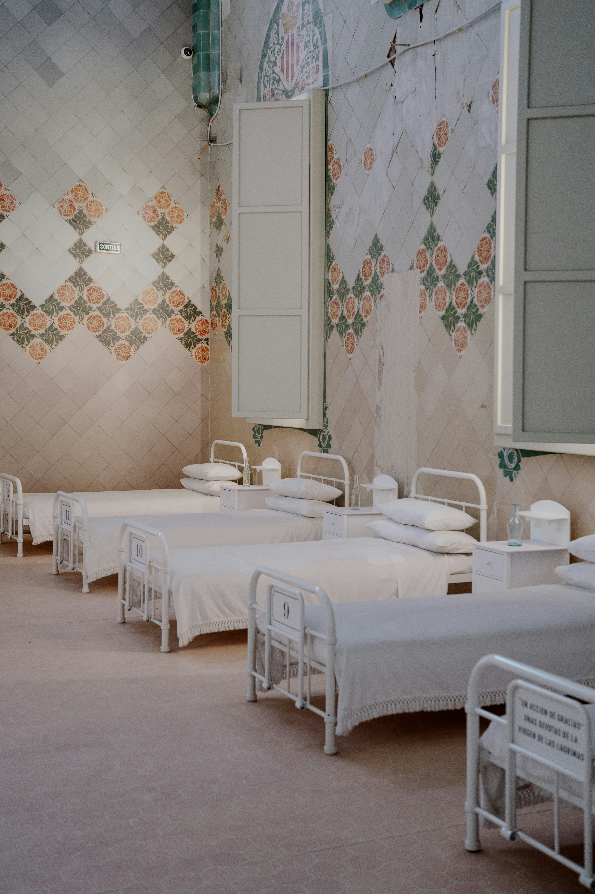
:::
::::

::::aside
Photo by <a href="https://unsplash.com/@papayaboii?utm_source=unsplash&utm_medium=referral&utm_content=creditCopyText">Zheyu Huang</a> on <a href="https://unsplash.com/photos/a-row-of-beds-in-a-room-with-tiled-walls-pKRL1XaO_zE?utm_source=unsplash&utm_medium=referral&utm_content=creditCopyText">Unsplash</a>
::::


## Observational data{background-color='#766d75' visibility="uncounted"}

:::: columns
::: {.column width="60%"}
* Model of 200+ variables predicting in-hospital mortality

* Whether the patient had breakfast was a huge predictor of mortality

* Already dead or nearly dead patients don't get breakfast

* Statistically true, but practically useless
:::
  
::: {.column width="40%"}

:::
::::

::::aside
Photo by <a href="https://unsplash.com/@papayaboii?utm_source=unsplash&utm_medium=referral&utm_content=creditCopyText">Zheyu Huang</a> on <a href="https://unsplash.com/photos/a-row-of-beds-in-a-room-with-tiled-walls-pKRL1XaO_zE?utm_source=unsplash&utm_medium=referral&utm_content=creditCopyText">Unsplash</a>
::::


## Observational data
### Confounding

* Every variable is complex, think about your age for example, that predicts a lot about you but not everything and it also comes with "baggage"

* No statistical method makes the problem of confounding disappear

::::aside
DOI: [10.1371/journal.pmed.1005282](https://journals.plos.org/plosmedicine/article?id=10.1371/journal.pmed.1005282)
::::


## Observational data{visibility="uncounted"}
### Confounding

* Every variable is complex, think about your age for example, that predicts a lot about you but not everything and it also comes with "baggage"

* No statistical method makes the problem of confounding disappear

* "We will use propensity score matching to adjust for confounding" - this is an inadequate statement without a lot more detail

::::aside
DOI: [10.1371/journal.pmed.1005282](https://journals.plos.org/plosmedicine/article?id=10.1371/journal.pmed.1005282)
::::


## Observational data

* Complex statistical methods, such as matching, are often applied with little deep thought

* Not a magic wand, can make things worse


::::aside
DOI: [10.1016/j.jacc.2016.10.060](https://pubmed.ncbi.nlm.nih.gov/28104076/)
::::

## Observational data{visibility="uncounted"}

* Complex statistical methods, such as matching, are often applied with little deep thought

* Not a magic wand, can make things worse

* What's needed is a thorough understanding of the data and the relationships between variables

* Conventional statistical methods can be just as good as matching; it's the thinking not the method that's important

::::aside
DOI: [10.1016/j.jacc.2016.10.060](https://pubmed.ncbi.nlm.nih.gov/28104076/)
::::
## Observational data
### Variable selection

* Common research problem: we have a large number of potential predictors/confounders and we want to know the key subset of important predictors

* Forwards stepwise selection should never be used. DOI: [10.1186/s40537-018-0143-6](https://link.springer.com/article/10.1186/s40537-018-0143-6)

* Backwards selection is better, also other techniques such as LASSO

## Observational data{background-color='white'}
### Draw a casual diagram

:::: columns
::: {.column width="50%"}
* No statistical or AI algorithm can understand chemistry, biology, social determinants, etc

* Draw a causal diagram, think about the data and the question; think about who and what are missing
:::
  
::: {.column width="50%"}
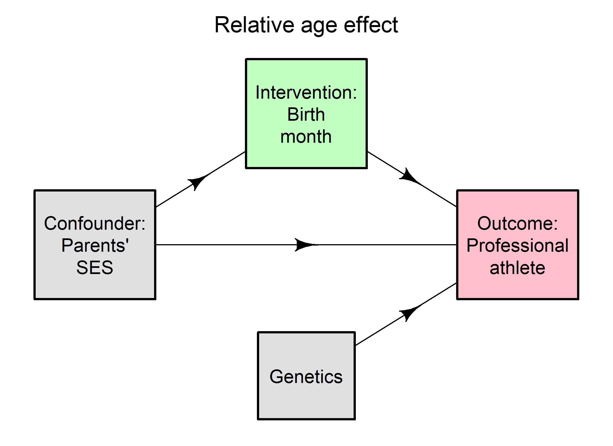

<!--- from AIS course --->
:::
::::


## Dependence{background-color='#698B69'}

* Data is often correlated
  + Repeated data from the same person
  + Repeated data from the same clinic, town, school, etc

## Dependence{visibility='uncounted' background-color='#698B69'}

* Data is often correlated
  + Repeated data from the same person
  + Repeated data from the same clinic, town, school, etc

* Following people/places repeated can be a great design ...

* ... but the repeated data must be included in the analyses

## Dependence{background-color='#698B69'}

:::incremental
* Many common statistical methods assume data is independent (e.g., t-test, linear regression)

* Each observation is whole "packet" of new information

* That's not true when we follow individuals repeatedly

* Treating correlated variables as independent falsely increases the sample size and the statistical certainty (risk of Type&nbsp;1 errors)
:::

## Dependence{background-color='#698B69'}

<!--- from plot_dependence.R --->

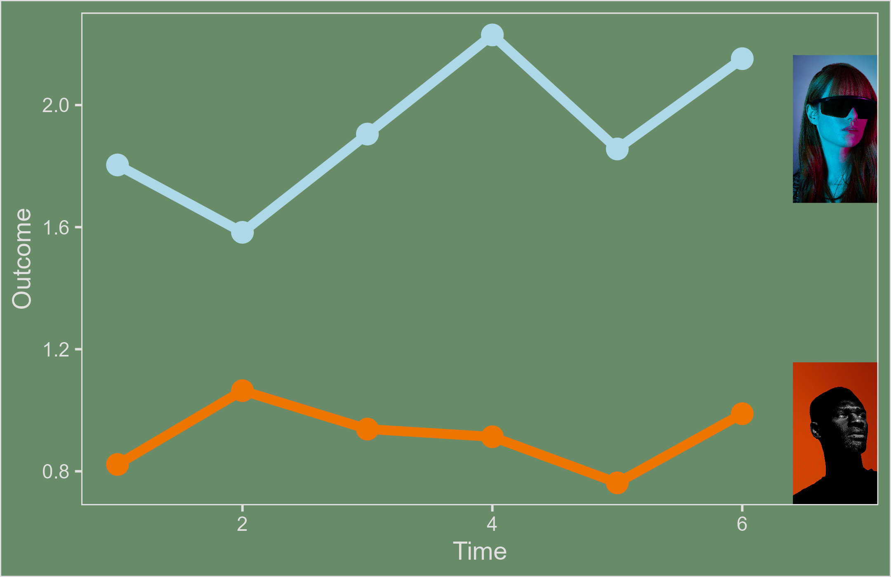{height=520}

::::aside
Photos by <a href="https://unsplash.com/@lucasgouvea?utm_source=unsplash&utm_medium=referral&utm_content=creditCopyText">Lucas Gouvêa</a> on <a href="https://unsplash.com/photos/a-woman-with-red-hair-and-sunglasses-vkCUpYy6xGU?utm_source=unsplash&utm_medium=referral&utm_content=creditCopyText">Unsplash</a> and <a href="https://unsplash.com/photos/man-wearing-black-shirt-aoEwuEH7YAs?utm_source=unsplash&utm_medium=referral&utm_content=creditCopyText">Unsplash</a>
::::

## Dependence{background-color='#698B69'}

:::: columns
::: {.column width="55%"}
* Study of heart monitors in heart failure patients
* 29 patients monitored for 3&nbsp;days wearing multiple devices
* Wider confidence intervals (more uncertainty) after accounting for within-person dependence
:::
  
::: {.column width="45%"}
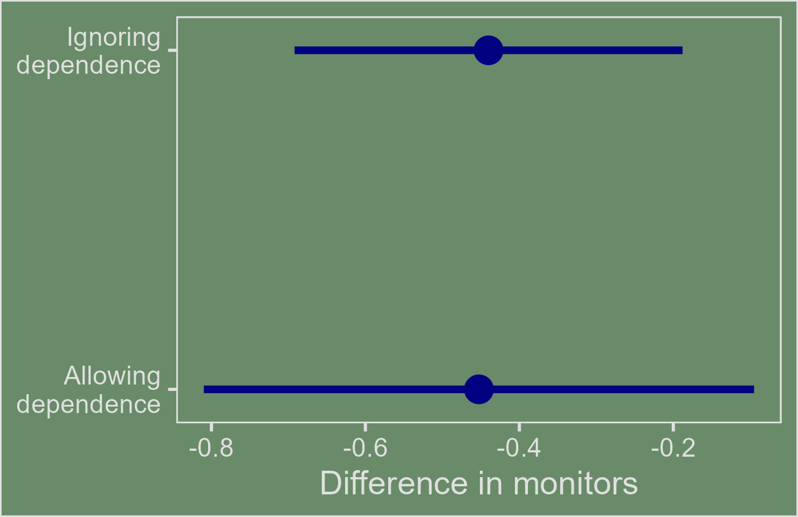{.absolute top='120' right='0' width=480}
<!--- from plot_dependence --->
:::
::::


::::aside
From DOI: [10.64898/2026.04.07.26350296](https://www.medrxiv.org/content/10.64898/2026.04.07.26350296v2), thanks to Lee Jones
::::

## Dependence{background-color='#476685'}
### Summary

:::: columns
::: {.column width="50%"}
* Dependence is often missed

* Likely to increase the risk of a Type&nbsp;1 error

* Fixable with statistical adjustment
:::
  
::: {.column width="50%"}
{.absolute top="50" right="0" width="410"}
:::
::::

::::aside
Photo by <a href="https://unsplash.com/@soymeraki?utm_source=unsplash&utm_medium=referral&utm_content=creditCopyText">Javier Allegue Barros</a> on <a href="https://unsplash.com/photos/silhouette-of-a-road-signage-during-golden-hour-0nOP5iHVaZ8?utm_source=unsplash&utm_medium=referral&utm_content=creditCopyText">Unsplash</a>
::::


# Closing remarks{background-image='figures/kevin-et-laurianne-langlais-iMRlp_Ldxus-unsplash.jpg' background-opacity=0.4 background-size='cover'}

<!-- instead of aside -->
<br><br><br><br><br><p style="font-size:80%">
Photo by <a href="https://unsplash.com/@laukev?utm_source=unsplash&utm_medium=referral&utm_content=creditCopyText">Kévin et Laurianne Langlais</a> on <a href="https://unsplash.com/photos/brown-wooden-dock-on-sea-during-daytime-iMRlp_Ldxus?utm_source=unsplash&utm_medium=referral&utm_content=creditCopyText">Unsplash</a></p>


## Importance of study design

::: incremental
* "There are only a handful of ways to do a study properly but a thousand ways to do it wrong", David Sackett

* "You cannot fix with analysis what you bungle by design", from _Planning Research on Higher Education_ by Light, Singer and Willett

* Steer researchers towards simpler designs
:::

## Nudge{background-color='#213e46'}

:::: columns
::: {.column width="60%"}
* Ask researchers about publishing a protocol, checking their statistical models, sharing their data/code

* Steer researchers away from clinical prediction models, especially if nobody on the team has statistical qualifications
:::
  
::: {.column width="40%"}
{height=490 .absolute top='60' right='0'}
:::
::::

::::aside
Photo by <a href="https://unsplash.com/@35mm?utm_source=unsplash&utm_medium=referral&utm_content=creditCopyText">35mm</a> on <a href="https://unsplash.com/photos/a-row-of-street-signs-sitting-on-the-side-of-a-road-IstXvxHGoA4?utm_source=unsplash&utm_medium=referral&utm_content=creditCopyText">Unsplash</a>
::::

## Online resources

* Long list of short and very good statistics notes from Bland & Altman [here](https://www-users.york.ac.uk/~mb55/pubs/pbstnote.htm)

* Reference Collection to push back against “Common Statistical Myths” [here](https://discourse.datamethods.org/t/reference-collection-to-push-back-against-common-statistical-myths/1787)

## Papers/books

* Book: [The Art of Statistics](https://www.google.com.au/books/edition/The_Art_of_Statistics/04-FDwAAQBAJ?hl=en) David Spiegelhalter

* Paper: [Competing risks](https://pubmed.ncbi.nlm.nih.gov/25146097/)

* Paper: [Immortal time bias](https://jamanetwork.com/journals/jama/article-abstract/2776315)

* Papers: [Dichotomania](https://pubmed.ncbi.nlm.nih.gov/16217841), [Dichotomania](https://doi.org/10.1093/oxfordjournals.aje.a117020)

* Papers: [Equivalence](https://pmc.ncbi.nlm.nih.gov/articles/PMC12406809), [Equivalence](http://bmj.com/content/311/7003/485.full)

* Papers: [Blinding](https://www.nature.com/articles/526182a), [Blinding](https://www.bmj.com/content/321/7259/504.full)

## Phew!{background-color='white'}


:::: aside
<p style="color:black">from Olympics on giphy</p>
::::

