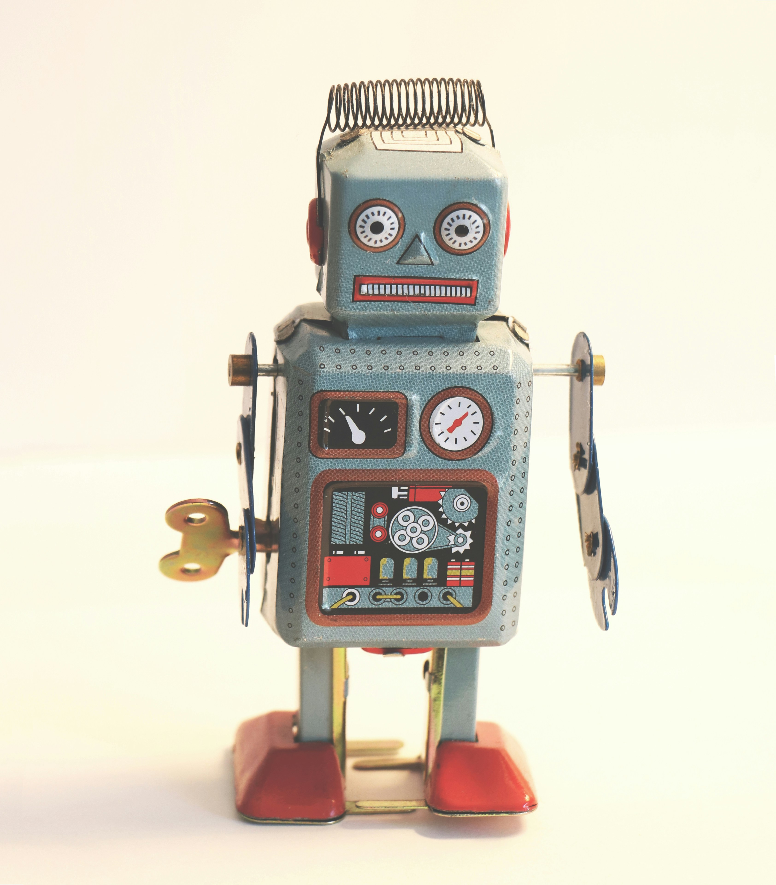
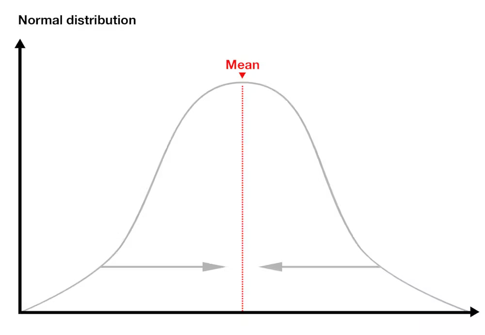
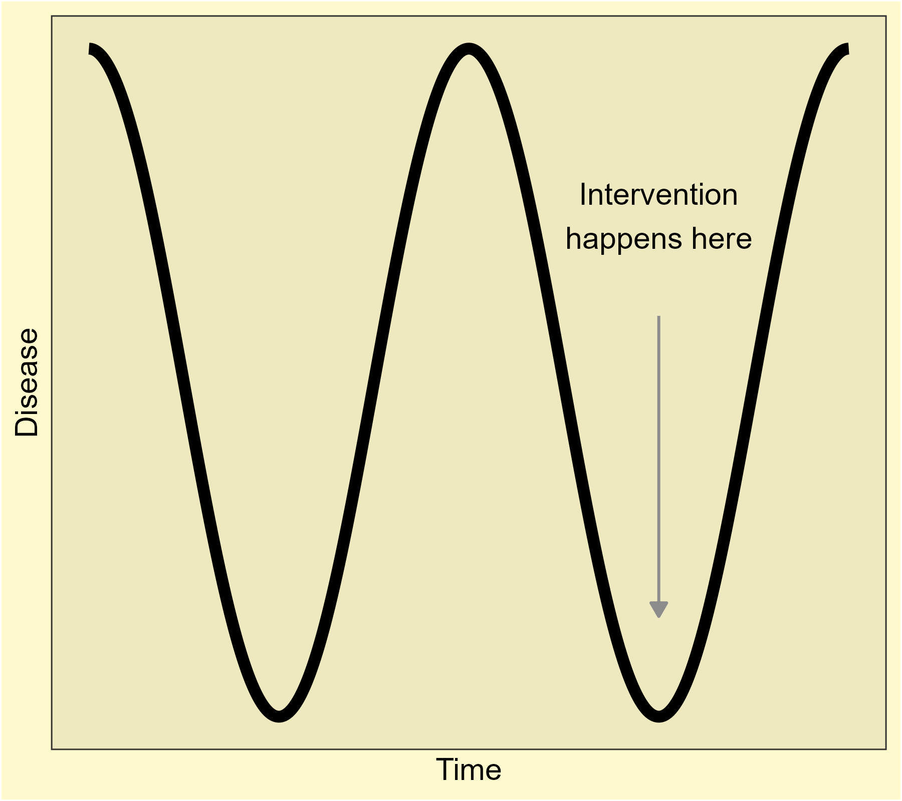
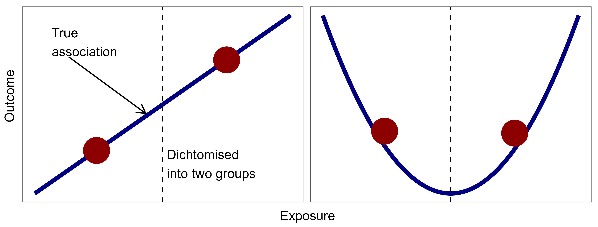
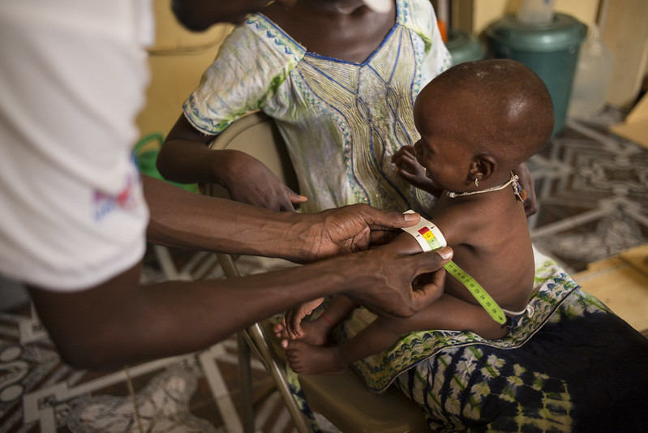
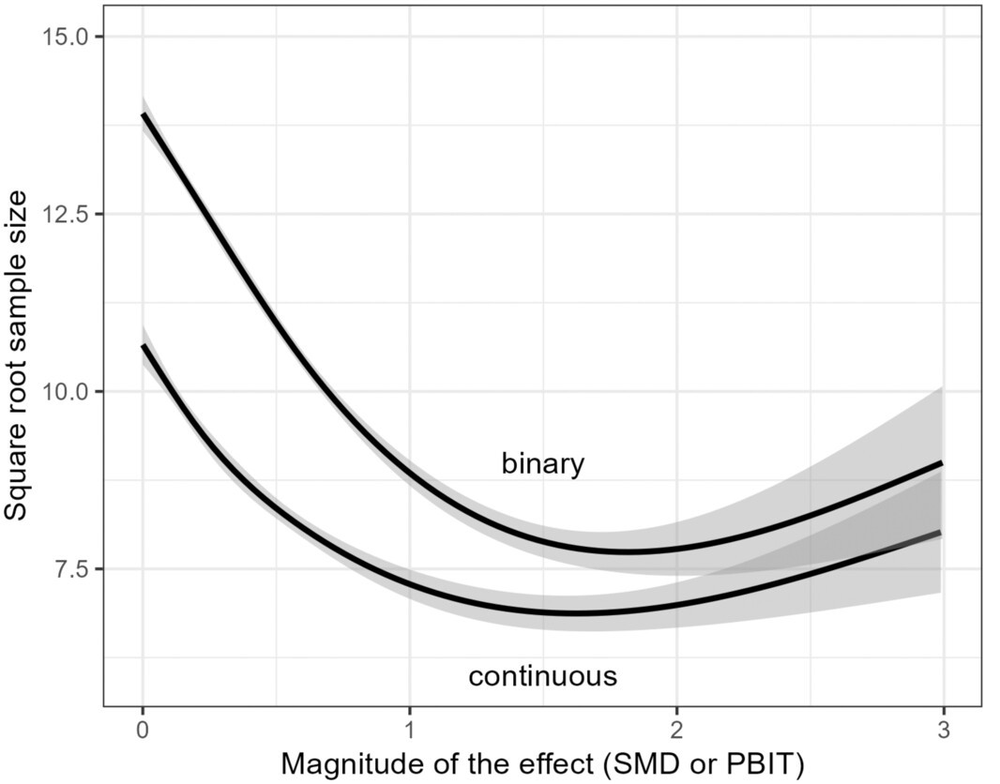
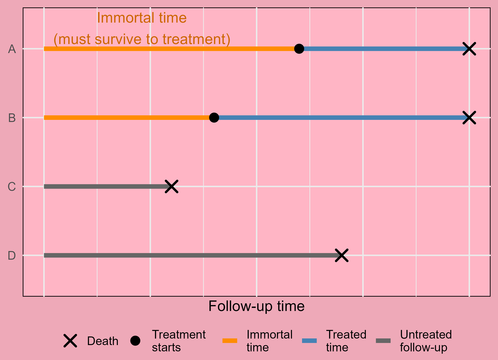
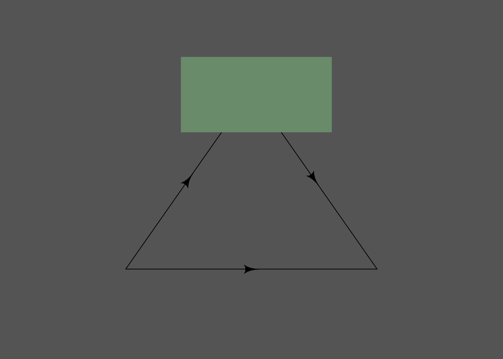
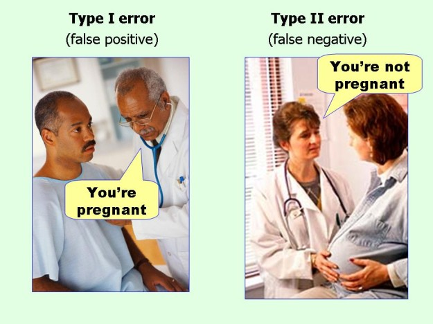

## Outline{background-color='#ffc100'}

<!--- have 3 hours --->

:::: columns
::: {.column width="50%"}

* Scale of bad research

* Bad designs that can be fixed at source

* Resources
:::
  
::: {.column width="50%"}
<iframe src="https://giphy.com/embed/RK9E0eC8LvDmI3QddR" width="480" height="480" style="" frameBorder="0" class="giphy-embed" allowFullScreen></iframe>

:::
::::

::::aside

<a href="https://giphy.com/gifs/man-talking-text-balloon-RK9E0eC8LvDmI3QddR">via @darienson on GIPHY</a>

::::

## Disclaimer

* I am giving a surface-level summary of some statistical issues

# Current problems in health and medical research{background-image='figures/simon-wilkes-S297j2CsdlM-unsplash.jpg' background-opacity=0.4 background-size='cover'}

<!-- instead of aside -->
     

Photo by <a href="https://unsplash.com/@simonfromengland?utm_source=unsplash&utm_medium=referral&utm_content=creditCopyText">Simon Wilkes</a> on <a href="https://unsplash.com/photos/green-leafed-tree-surrounded-by-fog-during-daytime-S297j2CsdlM?utm_source=unsplash&utm_medium=referral&utm_content=creditCopyText">Unsplash</a>

## First concerns{background-color='#ddd6cc'}

:::: columns
::: {.column width="60%"}
* 1988: Bland and Altman: “Bad statistics makes bad research, bad research may lead to bad medicine, and bad medicine may cost lives.”

:::
  
::: {.column width="40%"}
{.absolute top="70" right="-20" width="420"}
:::
::::

::::aside
Photo from Oxford Clinical Trials Research Unit
::::

## First concerns{background-color='#ddd6cc' visibility="uncounted"}

:::: columns
::: {.column width="60%"}
* 1988: Bland and Altman: “Bad statistics makes bad research, bad research may lead to bad medicine, and bad medicine may cost lives.”

* 1994: Doug Altman wrote about "The scandal of _poor_ medical research" in the _BMJ_

* 2015: Doug: Wish I'd said "bad"
:::
  
::: {.column width="40%"}
{.absolute top="70" right="-20" width="420"}
:::
::::

::::aside
Photo from Oxford Clinical Trials Research Unit
::::

## Research waste

* An estimated 85% of research is wasted due to:
  + Badly chosen research questions
  + Biases in study design
  + Poor reporting

::::aside
[Glasziou & Chalmers](https://www.bmj.com/content/363/bmj.k4645) "Research waste is still a scandal" _BMJ_ 2018
::::

## Lancet series of research waste

Correctable weaknesses in the design, conduct, and analysis of biomedical and public health research studies can produce misleading results and waste valuable resources. Small effects can be difficult to distinguish from bias introduced by study design and analyses. An absence of detailed written protocols and poor documentation of research is common. Information obtained might not be useful or important, and statistical precision or power is often too low or used in a misleading way. Insufficient consideration might be given to both previous and continuing studies. Arbitrary choice of analyses and an overemphasis on random extremes might affect the reported findings. Several problems relate to the research workforce, including failure to involve experienced statisticians and methodologists, failure to train clinical researchers and laboratory scientists in research methods and design, and the involvement of stakeholders with conflicts of interest. Inadequate emphasis is placed on recording of research decisions and on reproducibility of research. Finally, reward systems incentivise quantity more than quality, and novelty more than reliability.

:::: aside
DOI: [10.1016/S0140-6736(13)62227-8](https://pubmed.ncbi.nlm.nih.gov/24411645/) from 2014
::::

## Significance obsession{background-color='white'}

{width=770}

::::aside

Z-values extracted from confidence intervals in _Medline_ between 1976 and 2019. DOI: [10.1111/stan.12241](https://onlinelibrary.wiley.com/doi/full/10.1111/stan.12241)

::::

## Meta-research studies

* 1,013 out of 1,659 trials were at high risk of bias. Estimated cost of bad trials was £726 million to £8 billion. DOI: [10.1186/s13063-022-06415-5](https://trialsjournal.biomedcentral.com/articles/10.1186/s13063-022-06415-5)

* Out of 606 COVID-19 prediction models, only 7 were useful for policy. DOI: [10.1136/bmj.m1328](https://www.bmj.com/content/369/bmj.m1328)

* Only eight of 20 papers on linear regression were computationally reproducible. DOI: [10.64898/2026.04.07.26350286](https://www.medrxiv.org/content/10.64898/2026.04.07.26350286.abstract)

## AI slop{background-color='white'}

::: aside

DOI:
[10.1016/j.jclinepi.2026.112203](https://www.sciencedirect.com/science/article/pii/S0895435626000788)

:::

## Can ethics help?

* 2024 change to the Declaration of Helsinki: 
   + "Medical research involving human participants must have a scientifically sound and rigorous design and execution that are likely to produce reliable, valid, and valuable knowledge and avoid research waste."

* Ethics can be used to stop poor study designs

* Ideal time to intervene to avoid wasted time

## Does ethics help?

* Only 35% of Australian HRECs had a qualified statistician as full member or available for consultation (95% CI: 31% to 40%)

* Many HRECs do not examine study design
  + 
“It is NOT up to the committee to design the research”
 
  + 
Seen as an institutional responsibility to examine study design

  + 
Perceived hierarchy of studies which do and do not require statistical review

::::aside
DOI: [10.1162/QSS.a.479/136239](https://direct.mit.edu/qss/article/doi/10.1162/QSS.a.479/136239)
::::

## Can AI help with study design?{background-color='#fbf8e5'}

:::: columns
::: {.column width="60%"}
* AI models will p-hack and provide pleasing answers

* TO DO, add references, see Investigator Grant

* AI peer review of completed work is promising
:::
  
::: {.column width="40%"}

:::
::::

::::aside

Photo by <a href="https://unsplash.com/@emilipothese?utm_source=unsplash&utm_medium=referral&utm_content=creditCopyText">Emilipothèse</a> on <a href="https://unsplash.com/photos/gray-and-white-robot-illustration-FTfjMijq-Ws?utm_source=unsplash&utm_medium=referral&utm_content=creditCopyText">Unsplash</a>

::::

# Bad designs{background-image='figures/jon-tyson-od1pKBU7PKA-unsplash.jpg' background-opacity=0.5 background-size='cover'}

<!-- instead of aside -->
          
Photo by <a href="https://unsplash.com/@jontyson?utm_source=unsplash&utm_medium=referral&utm_content=creditCopyText">Jon Tyson</a> on <a href="https://unsplash.com/photos/orange-and-white-prescription-bottle-od1pKBU7PKA?utm_source=unsplash&utm_medium=referral&utm_content=creditCopyText">Unsplash</a>

## Regression to the mean{background-color='white'} 

:::: columns
::: {.column width="65%"}
* When things are at their best, they will often get worse

* When things are at their worst, they will often get better

:::
  
::: {.column width="35%"}
{.absolute bottom="100" right="-40" width="420"}

:::
::::

::::aside
[Conversation article](https://theconversation.com/regression-to-the-mean-or-why-perfection-rarely-lasts-74694)
::::

## Regression to the mean{background-color='white' visibility="uncounted"} 

:::: columns
::: {.column width="65%"}
* When things are at their best, they will often get worse

* When things are at their worst, they will often get better

* This happens because of random chance, not real change

* A bad design can easily make random chance look like real change
:::
  
::: {.column width="35%"}
{.absolute bottom="100" right="-40" width="420"}

:::
::::

::::aside
[Conversation article](https://theconversation.com/regression-to-the-mean-or-why-perfection-rarely-lasts-74694)
::::

## Example study designs
### Regression to the mean

::: incremental
* After a period of unusually high hospital acquired infections, new hand washing policies are introduced. Infections are compared pre- and post-policy change.

* Patients with extreme back pain are referred to a new back program. Patients are measured at baseline and six weeks follow-up.
:::

## Regression to the mean

* Happens in studies that include time
   + Individuals measured before and after some intervention
   + Monthly or weekly statistics, e.g., death counts

::: incremental
* Pre-post study designs

* Only occurs if there is measurement error, also known as noise or randomness
  + 
Question: Is there anything in health that does not have some measurement error?

::: 

## Design solutions 
### Regression to the mean

* Add a control group with no intervention
  + Average change from baseline in the control group is then a good estimate of regression to the mean

## Design solutions{visibility="uncounted"} 
### Regression to the mean

* Add a control group with no intervention
  + Average change from baseline in the control group is then a good estimate of regression to the mean

* Add multiple baseline measures per participant
   + Reduce measurement error and hence reduce regression to the mean

## Seasonal changes{background-color='#EEE9BF'}

:::: columns
::: {.column width="50%"}
* Seasonal changes can look like real change

* Many diseases are seasonal

* (Figure shows idealised smooth seasonal pattern, real patterns will be noiser)
:::
  
::: {.column width="50%"}
<!--- from plot_season.R --->

:::
::::

## Regression to the mean{background-color='#476685'}
### Summary

:::: columns
::: {.column width="50%"}
* Common

* Can be a large bias

* Fixable
:::
  
::: {.column width="50%"}
{.absolute top="50" right="0" width="410"}
:::
::::

::::aside
Photo by <a href="https://unsplash.com/@soymeraki?utm_source=unsplash&utm_medium=referral&utm_content=creditCopyText">Javier Allegue Barros</a> on <a href="https://unsplash.com/photos/silhouette-of-a-road-signage-during-golden-hour-0nOP5iHVaZ8?utm_source=unsplash&utm_medium=referral&utm_content=creditCopyText">Unsplash</a>
::::

## Dichotomania

* Categorise continuous data, e.g., continuous blood pressure categorised to low vs high

:::incremental
* Very common problem in health and medical research

* "inefficient at best and misleading and arbitrary at worst", [Frank Harrell](https://www.fharrell.com/post/errmed/#catg)

* "the stupidity, the criminal vandalism, the wanton destruction of information involved in dichotomisation", [Stephen Senn](https://statmodeling.stat.columbia.edu/2026/02/14/the-stupidity-the-criminal-vandalism-the-wanton-destruction-of-information-involved-in-dichotomisation/)

* Can also be in change variables, e.g., response defined as an increase from baseline of at least 10&nbsp;mmHg
:::

## Dichotomania{background-color='white'}
### Discarding information

* Inefficient and potentially misleading

## Dichotomania
### Malnutrition example

{width=600}

::::aside
Image from [Sylvain Cherkaoui](https://www.flickr.com/photos/eu_echo/22568901058/in/photostream/), 
EU Civil Protection and Humanitarian Aid on Flickr [CC BY-ND 2.0](https://creativecommons.org/licenses/by-nd/2.0/deed.en)
::::

## Dichotomania{background-color='white'}
### Consequence: lower statistical power

:::: columns
::: {.column width="50%"}
* "Only about 60% of the information is retained after dichotomization"

* "Burdening more participants than necessary is wasteful, costly, and unethical"
:::
  
::: {.column width="50%"}
{width=400}
:::
::::

::::aside

DOI: [10.1002/sim.70402](https://onlinelibrary.wiley.com/doi/full/10.1002/sim.70402)

::::

## Dichotomania
### Unacceptable excuses to dichotomise

* This approach is standard in our field

* We used a clinically meaningful cut-off

## Dichotomania
### Fixes

:::: columns
::: {.column width="55%"}
* Do not discard collected information

* Use statistical models for continuous outcomes, e.g.
  + linear regression instead of logistic regression
  + t-test instead of chi-squared test
:::
  
::: {.column width="45%"}
{.absolute top="50" right="0" width="410"}
:::
::::

::::aside
Photo by <a href="https://unsplash.com/@rechaoktaviani?utm_source=unsplash&utm_medium=referral&utm_content=creditCopyText">Recha Oktaviani</a> on <a href="https://unsplash.com/photos/person-holding-gray-and-black-metal-tool-5tYUk7sZzqc?utm_source=unsplash&utm_medium=referral&utm_content=creditCopyText">Unsplash</a>
::::

## Dichotomania{background-color='#476685'}
### Summary

:::: columns
::: {.column width="50%"}
* Common

* Reduces study value

* Increases the required sample size, puts more people at risk

* Fixable
:::
  
::: {.column width="50%"}
{.absolute top="50" right="0" width="410"}
:::
::::

::::aside
Photo by <a href="https://unsplash.com/@soymeraki?utm_source=unsplash&utm_medium=referral&utm_content=creditCopyText">Javier Allegue Barros</a> on <a href="https://unsplash.com/photos/silhouette-of-a-road-signage-during-golden-hour-0nOP5iHVaZ8?utm_source=unsplash&utm_medium=referral&utm_content=creditCopyText">Unsplash</a>
::::

## Immortal time bias

* Occurs in studies that follow people over time

* Study design accidentally creates a period of time when people are "immortal"

* Can be difficult to spot as flawed study designs appear intuitive

* Studies involving time are generally far more complicated 

## Immortal time bias{background-color='#FFB5C5'}

<!--- from plot_immortal.R --->

{width=770}

## Immortal time bias
### Recent example

* Breast cancer patients taking glucagon-like peptide-1 receptor agonists (GLP-1 RAs) had a large reduction in mortality compared with control patients (no meds)

* Patients in treatment group had to have 2+ GLP-1 RA prescriptions, creating immortal time

:::incremental
* Received large media attention; cancer patients asking doctors for treatment; false hope
:::

::::aside
DOI: [10.1001/jamanetworkopen.2026.12133](https://jamanetwork.com/journals/jamanetworkopen/fullarticle/2848788)
::::

## Immortal time

* More often happens in routinely collected data

:::incremental
* Researchers look backwards in time from existing data

* Don't see the people they have lost

* Think about a prospective study, who would have been lost to follow-up?
:::

## Immortal time
### Fixes

:::: columns
::: {.column width="59%"}
* Never condition on the future

* Use a state-space model combined with survival analysis that allows people to move between states (advanced statistical method)
:::
  
::: {.column width="41%"}
{.absolute top="50" right="0" width="410"}
:::
::::

::::aside
Photo by <a href="https://unsplash.com/@rechaoktaviani?utm_source=unsplash&utm_medium=referral&utm_content=creditCopyText">Recha Oktaviani</a> on <a href="https://unsplash.com/photos/person-holding-gray-and-black-metal-tool-5tYUk7sZzqc?utm_source=unsplash&utm_medium=referral&utm_content=creditCopyText">Unsplash</a>
::::

## Immortal time
### Fixes

<!--- from plot_states --->

## Immortal time bias{background-color='#476685'}
### Summary

:::: columns
::: {.column width="50%"}
* Not uncommon

* Can be a very large bias

* Fixable but requires advanced methods and lots of thinking
:::
  
::: {.column width="50%"}
{.absolute top="50" right="0" width="410"}
:::
::::

::::aside
Photo by <a href="https://unsplash.com/@soymeraki?utm_source=unsplash&utm_medium=referral&utm_content=creditCopyText">Javier Allegue Barros</a> on <a href="https://unsplash.com/photos/silhouette-of-a-road-signage-during-golden-hour-0nOP5iHVaZ8?utm_source=unsplash&utm_medium=referral&utm_content=creditCopyText">Unsplash</a>
::::

## Sample size

* How many people/participants/patients do we need to answer our research question?

* Key unknowns:
  + Difference between groups
  + Standard deviation (variance) in outcome
  + Significance level (avoid type~1 errors), often 5\%
  + Statistical power (avoid type~2 errors), often 80\%

## Sample size{background-color='#e2ffe3'}

## {background-color='#968c96'} 

:::: columns
::: {.column width="70%"}

* Sample size must be:
  + Sufficiently large to have reasonable chance of answering the
research question
  + Reduce costs of:
    - Money
    - Delayed decision
    - Participant time
    - Researcher time
:::

::: {.column width="30%"}

:::
::::

::::aside
Photo by <a href="https://unsplash.com/@miracleday?utm_source=unsplash&utm_medium=referral&utm_content=creditCopyText">Elena Mozhvilo</a> on <a href="https://unsplash.com/photos/small-gold-balance-scale-on-colorful-wood-j06gLuKK0GM?utm_source=unsplash&utm_medium=referral&utm_content=creditCopyText">Unsplash</a>
::::

## Sample size 
### Catch-22

* Studies that are very similar to previous studies can estimate all paramaters easily

## Using correlation for causation

## Matching

## Clustering

See Lee's example

## Count data?

## Survival data => survival analysis

## Table 2 fallacy

## Prediction models

## Blinding

Add effect size when blinding was not used.

## Randomising

## Trials must be registered with protocol

randomized trials should not receive ethical approval unless the trial team contains methodological and statistical expertise (Pirosca et~al., 2022)

Look for slides from one-day talk

## Parametric tests?

# Closing remarks{background-image='figures/kevin-et-laurianne-langlais-iMRlp_Ldxus-unsplash.jpg' background-opacity=0.4 background-size='cover'}

<!-- instead of aside -->
     

Photo by <a href="https://unsplash.com/@laukev?utm_source=unsplash&utm_medium=referral&utm_content=creditCopyText">Kévin et Laurianne Langlais</a> on <a href="https://unsplash.com/photos/brown-wooden-dock-on-sea-during-daytime-iMRlp_Ldxus?utm_source=unsplash&utm_medium=referral&utm_content=creditCopyText">Unsplash</a>

## Importance of study design

::: incremental
* "There are only a handful of ways to do a study properly but a thousand ways to do it wrong", David Sackett

* "You cannot fix with analysis what you bungle by design", from _Planning Research on Higher Education_ by Light, Singer and Willett

* Steer researchers towards simpler designs
:::

## Online resources

* Long list of short and very good statistics notes from Bland & Altman [here](https://www-users.york.ac.uk/~mb55/pubs/pbstnote.htm)

* Reference Collection to push back against “Common Statistical Myths” [here](https://discourse.datamethods.org/t/reference-collection-to-push-back-against-common-statistical-myths/1787)

## Papers

