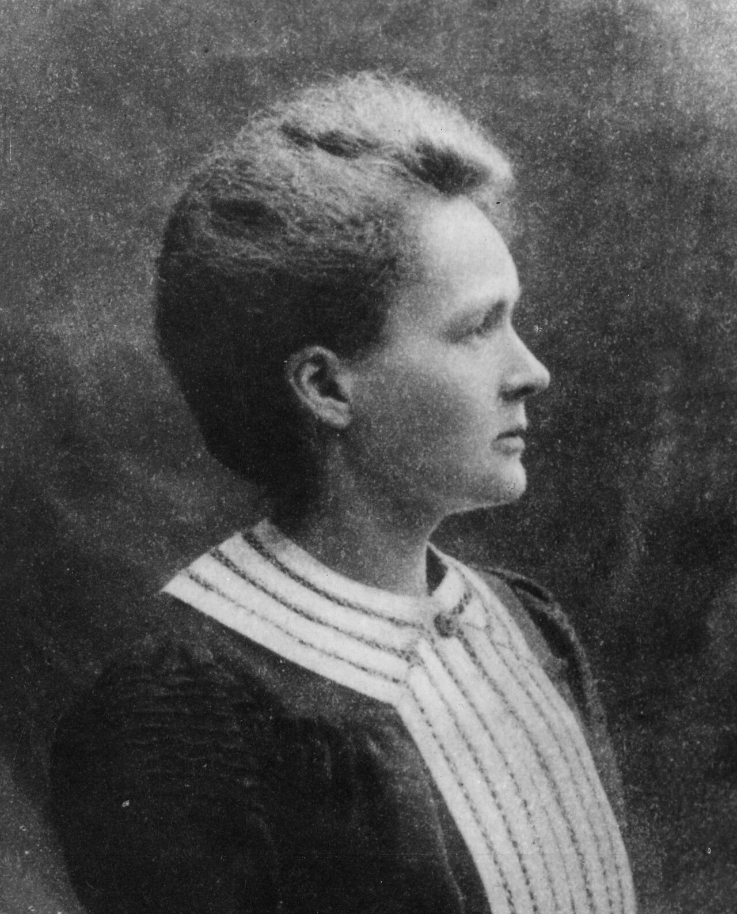
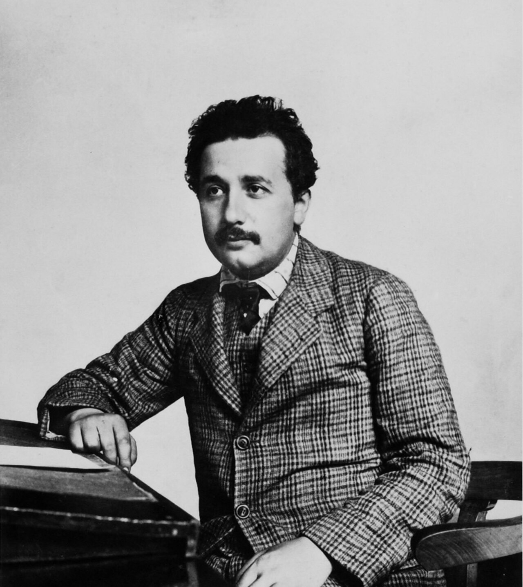
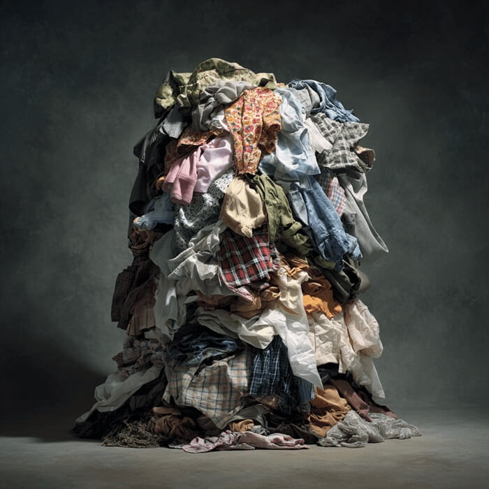
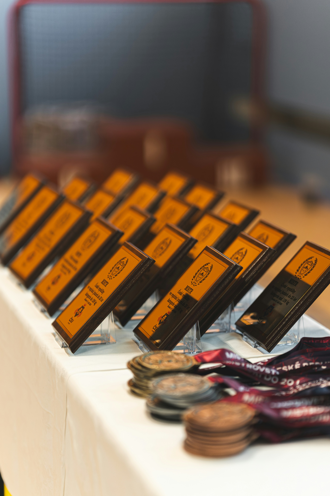

## My first professional job{background-image='figures/smith_kline_beecham.jpg' background-opacity=0.6 background-size='cover'}

* 1994

* Harlow, Essex

::::aside
[CC BY-SA 2.0](https://commons.wikimedia.org/w/index.php?curid=14189699), Stephen Craven
::::

<!--- 15 mins, Adrian first because his perspective includes setting the 'bigger picture' of the extent of the problem; three 15 minute talks from each of you, with 15 minutes at the end for questions from the audience --->

##

{width=390}
{width=390}

::::aside
Marie Curie by [Nobel foundation](http://nobelprize.org/nobel_prizes/physics/laureates/1903/marie-curie-bio.html), Albert Einstein by [Lucien Chavan](https://commons.wikimedia.org/w/index.php?curid=156735875), both public domain
::::

## {visibility='uncounted'}

{width=390}
{width=390}

  <!-- Centered text block overlaying both images -->
  

  
  How many discoveries should we expect per 10 years of a normal scientific career?
  
  

::::aside
Marie Curie by [Nobel foundation](http://nobelprize.org/nobel_prizes/physics/laureates/1903/marie-curie-bio.html), Albert Einstein by [Lucien Chavan](https://commons.wikimedia.org/w/index.php?curid=156735875), both public domain
::::

<!--- To become these people, researchers think they need to become these people (name game) --->

## My numbers{background-color='white'}

* #### 1 per 10 years for a discovery

* #### 1 per 2 years for replicating previous discoveries

## Prestige games{background-color='white'}

<!--- from https://orcid.org/0000-0001-8526-5486 --->

## Hyper-inflation{background-color='white'}

::::aside

DOI: [10.1016/j.jclinepi.2026.112203](https://www.sciencedirect.com/science/article/pii/S0895435626000788)

::::

## Slop signs

::::aside
Thanks to [Peer-Reviewed Slop](https://bsky.app/profile/peer-reviewed-slop.bsky.social); paper in [Elsevier journal](https://www.sciencedirect.com/science/article/abs/pii/S0010854524002881)
::::

## AI overload{background-color='white'}

{height=500}

::::aside

DOI: [10.1038/d41586-026-03196-8](https://www.nature.com/articles/d41586-026-03196-8)

::::

<!--- getting requests to collaborate. --->

# Fighting back{background-color='#d5c3a3'}

::::aside
from giphy
::::

## <xx-small style="color:transparent">Turn down the heat</xx-small>{background-image='figures/nature_articles.jpg' background-opacity=1 background-color='white' background-size='contain'}

## Future headline?{background-color='#232929'}

:::: columns
::: {.column width="50%"}
University of X becomes the world's first university to put an upper limit on the number of papers staff should publish per year
:::
  
::: {.column width="50%"}

:::
::::
  
:::: aside
Image from [Sublimr](https://subli.mr/en/we-are-our-values) CC BY-NC 4.0
::::

## Individuals: leave paper trails{background-color='white'}

<!--- prove you are human -->

:::: aside

from BoxMedia on giphy

::::

## Governments and funders: Money for quality control

* The _American Society for Quality_ states that organisations typically spend 10 to 15% of their operating costs on quality-related costs 

:::incremental
* Using the health and medical research budget in Australia, this would mean $740 million per year on quality-related work
:::

## Incentives{background-color='#f8f9f3'}

:::: columns
::: {.column width="60%"}
* We need to shift the goalposts from quantity to quality

* Proposed random audits of universities, but these are expensive; DOI: [10.1371/journal.pone.0195613](https://journals.plos.org/plosone/article?id=10.1371/journal.pone.0195613)
:::
  
::: {.column width="40%"}
{width=350}
:::
::::
  
::::aside

Photo by <a href="https://unsplash.com/@adela_?utm_source=unsplash&utm_medium=referral&utm_content=creditCopyText">Adéla Dvořáková</a> on <a href="https://unsplash.com/photos/rows-of-awards-and-medals-displayed-on-a-table-4ZphoKmmNqk?utm_source=unsplash&utm_medium=referral&utm_content=creditCopyText">Unsplash</a>

::::

## Desperate times, desperate measures{background-color='#fdf5de'}

:::: columns
::: {.column width="60%"}
* LLM peer reviews can be good
:::
  
::: {.column width="40%"}
:::
::::

## Desperate times, desperate measures{background-color='#fdf5de' visibility='uncounted'}

:::: columns
::: {.column width="60%"}
* LLM peer reviews can be good

* What if the LLMs reviewed everything *and* the models rewarded rigorous and well-reported research?

* Create league tables? Label "low value" research?
:::
  
::: {.column width="40%"}
<iframe src="https://giphy.com/embed/7fc3TOvT3yDFicYxFM" width="480" height="480" style="" frameBorder="0" class="giphy-embed" allowFullScreen></iframe>

:::
::::

::::aside

Nope Cat via [GIPHY](https://giphy.com/gifs/blue-cat-nopecat-getting-good-7fc3TOvT3yDFicYxFM")

::::
