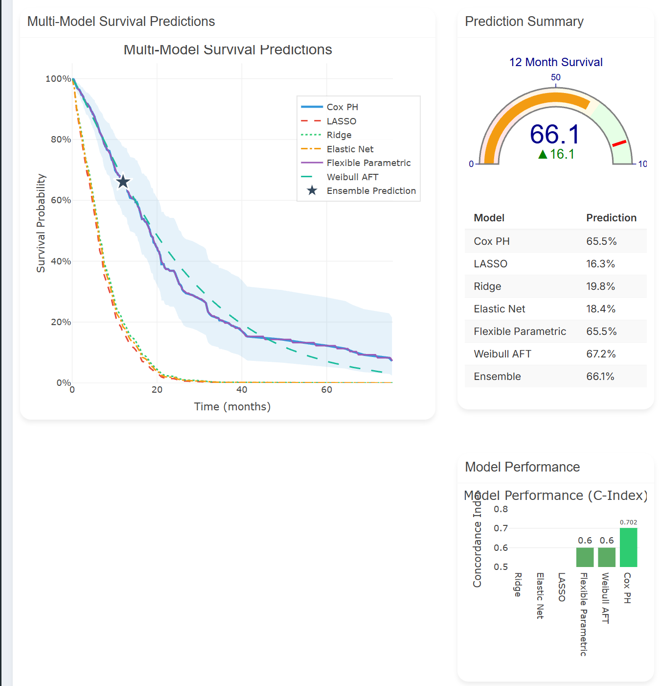

## Outline{background-color='#ffc100'}

<!--- 40 min? presentation --->

:::: columns
::: {.column width="50%"}

* Ramble

:::
  
::: {.column width="50%"}
<iframe src="https://giphy.com/embed/RK9E0eC8LvDmI3QddR" width="480" height="480" style="" frameBorder="0" class="giphy-embed" allowFullScreen></iframe>
:::
::::

::::aside

<a href="https://giphy.com/gifs/man-talking-text-balloon-RK9E0eC8LvDmI3QddR">via GIPHY</a>

::::

## My first professional job{background-image='figures/smith_kline_beecham.jpg' background-opacity=0.6 background-size='cover'}

::::aside
[CC BY-SA 2.0](https://commons.wikimedia.org/w/index.php?curid=14189699), Stephen Craven
::::

## x

Number of additional people randomised because people use dichotomous variables.

## Darren's blog

## Ethics stuff

People without statistical qualifications

# Labels

The Great Bear

[click here](https://web.archive.org/web/20041111062328/http://www.dareonline.org/artwork/patterson/patterson3.html)

## Machine Learning

:::: columns
::: {.column width="50%"}
"By employing best-practice machine-learning techniques, such as PCA" PMID: [38253940](https://pubmed.ncbi.nlm.nih.gov/38253940/)

"Utilizing an artificial intelligence-based machine learning approach a generalized linear mixed (GLM) model was developed ... " 

PMID: [40616247](https://pubmed.ncbi.nlm.nih.gov/40616247/)
:::
  
::: {.column width="50%"}

PMCID: [PMC12820067](https://pmc.ncbi.nlm.nih.gov/articles/PMC12820067/)
:::
::::

# Speed

## Flood of submissions{background-color='#edf4fa'}

{width=860}

::::aside

From [ArXiv](https://blog.arxiv.org/2026/10/01/updated-rate-limit-policy/)

::::

## dxx
Paper numbers. Metrics, people add top 2% to their name 

# Good reforms go bad{background-image='figures/joe-dudeck-lt4Pb2vhkyw-unsplash.jpg' background-opacity=0.8 background-size='cover' visibility="uncounted"}

Photo by <a href="https://unsplash.com/@joetography?utm_source=unsplash&utm_medium=referral&utm_content=creditCopyText">Joe Dudeck</a> on <a href="https://unsplash.com/photos/an-old-rusty-train-car-sitting-in-a-field-lt4Pb2vhkyw?utm_source=unsplash&utm_medium=referral&utm_content=creditCopyText">Unsplash</a>

## Data sharing

::: aside

DOI:
[10.1016/j.jclinepi.2026.112203](https://www.sciencedirect.com/science/article/pii/S0895435626000788)

:::

## Dorothy Blog

Do we need to rethink data sharing. Dorothy blog?

## OpenSafely

TO DO: Image of silver bullet, or use previous image of castle

Keep data safe

Allow lots more analysis

Solves ethical concerns

Keep the machines out

## Shiny{background-color='white'}

#### Mesothelioma personalized survival predictions

Anyone can make a shiny app

Crappy prediction model

::::aside
[from shiny](https://panacea.shinyapps.io/Mesothelioma/)
::::

## Hacking

<!--- from Alex --->

## Predict the next word

:::: columns
::: {.column width="40%"}
Julian Barnes
:::
  
::: {.column width="60%"}
{width=400}
:::
::::

::::aside
[CC BY-SA 4.0](https://commons.wikimedia.org/w/index.php?curid=81934217) By WanderingTrad - Own work, 
::::

<!--- chops off edges, Julian Barnes --->

## Predict the next pixel{background-color='white'}

:::: columns
::: {.column width="50%"}
AI

{width=400}
:::
  
::: {.column width="50%"}
Real

{width=400}
:::
::::

::::aside

Hat tip to [Sholto David](https://www.youtube.com/watch?v=G9KHwXNIJyk&t=318s); [Image 1](https://pmc.ncbi.nlm.nih.gov/articles/PMC13332335/figure/fsn372068-fig-0010/); [Paper 2](https://link.springer.com/article/10.1007/s12011-020-02268-8/figures/5)

::::

## Bonkers stuff

::::aside
Thanks to [Peer-Reviewed Slop](https://bsky.app/profile/peer-reviewed-slop.bsky.social); paper in [Elsevier journal](https://www.sciencedirect.com/science/article/abs/pii/S0010854524002881)
::::

## Upper limit on publication counts

Are you real?

Drumming one.

Machine learning, benefits, shift the AUC distribution?

Perfect predictions from alex. Like a pill working in everyone, does not happen.

## Changing drug treatment

If we could change the treatment we would, and people do, subgroup analysis!

<!--- pinch of salt that would make you wince --->

## Lasso

Everything about lasso and SVM screams 'statistics' to me, so why is it machine learning? Obsessed with labels. 

## Platform trial. 

Funding for platform trials only.

We need more one hit studies. Do the protocol, do the analysis, report the results. 

Don't mind target trials - stop and think. Should have protocols. 

Everything I see in lasso screams statistics. Meeting with Matt Wand.

No time for me to comment
https://www.nature.com/articles/d41586-026-03196-8

## Why are we here?{background-image='figures/childrens_hospital.jpg' background-opacity=0.9 background-size='cover'}
