## Rambly{background-color='#ffc100'}

<!--- 40 min? presentation --->

:::: columns
::: {.column width="50%"}

* Labels

* AI & ML

* Good things turning bad

* Prediction models

* Research fraud

:::
  
::: {.column width="50%"}
<iframe src="https://giphy.com/embed/RK9E0eC8LvDmI3QddR" width="480" height="480" style="" frameBorder="0" class="giphy-embed" allowFullScreen></iframe>

:::
::::

::::aside

<a href="https://giphy.com/gifs/man-talking-text-balloon-RK9E0eC8LvDmI3QddR">via @darienson on GIPHY</a>

::::

## My first professional job{background-image='figures/smith_kline_beecham.jpg' background-opacity=0.6 background-size='cover'}

* 1994

* Harlow, Essex

::::aside
[CC BY-SA 2.0](https://commons.wikimedia.org/w/index.php?curid=14189699), Stephen Craven
::::

## Taken as read

* Overall research quality is bad

* When I read a new paper my prior is "this is wrong" and the authors need to show me that they have worked carefully and thoroughly

## I see this in my sleep{background-color='white'}

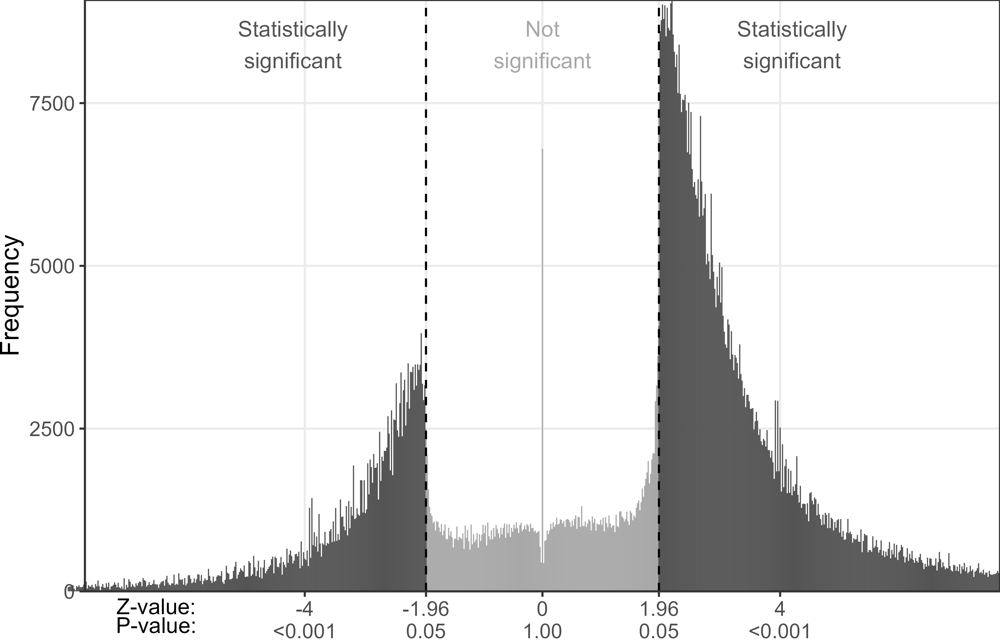

# Labels

The Great Bear

[click here](https://web.archive.org/web/20041111062328/http://www.dareonline.org/artwork/patterson/patterson3.html)

<!--- lived at Peter Fonda, went to university at Jean-Paul Satre --->

## Machine learning?

:::: columns
::: {.column width="50%"}
"By employing best-practice machine-learning techniques, such as PCA" PMID: [38253940](https://pubmed.ncbi.nlm.nih.gov/38253940/)

"Utilizing an artificial intelligence-based machine learning approach a generalized linear mixed (GLM) model was developed" 

PMID: [40616247](https://pubmed.ncbi.nlm.nih.gov/40616247/)
:::
  
::: {.column width="50%"}
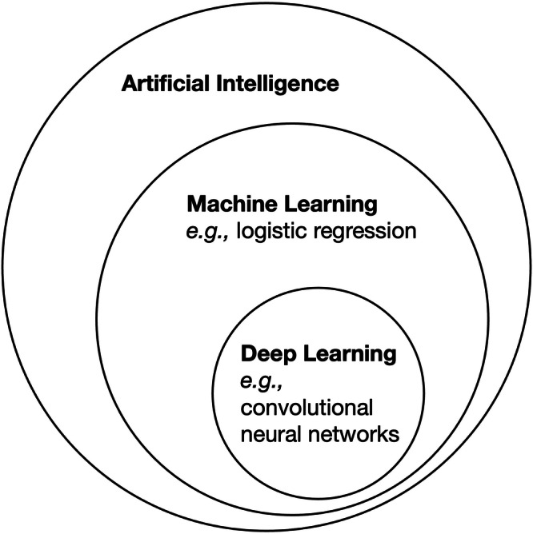

PMCID: [PMC12820067](https://pmc.ncbi.nlm.nih.gov/articles/PMC12820067/)
:::
::::

## Machine learning??{background-color='white'}

#### Lasso

{width=600}

#### Support vector machine

{width=650}

<!--- presentation by Matt Wand on SVMs --->

## I know big words{background-color='#0e0803'}

:::: columns
::: {.column width="50%"}
* Methodology

* Utilisation
:::
  
::: {.column width="50%"}
<iframe src="https://giphy.com/embed/Ll8zeNeGAFOV6PvKDF" width="480" height="259" style="" frameBorder="0" class="giphy-embed" allowFullScreen></iframe>
:::
::::

::::aside

<a href="https://giphy.com/gifs/muppets-Ll8zeNeGAFOV6PvKDF">via GIPHY</a>

::::

## Platform trials{background-color='white'}

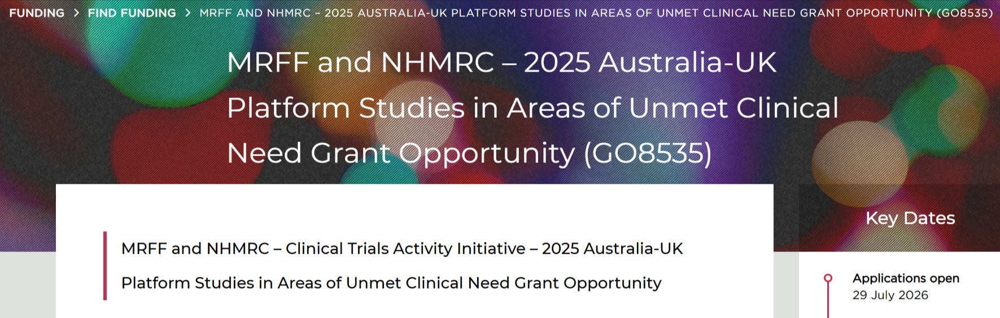

::::aside

From [NHMRC](https://www.nhmrc.gov.au/funding/find-funding/mrff-and-nhmrc-2025-australia-uk-platform-studies-areas-unmet-clinical-need-grant-opportunity-go8535)

::::

## Change is easy{background-color='#271d2d'}

:::: columns
::: {.column width="55%"}
* Do the protocol, do the analysis, report the results
:::
  
::: {.column width="45%"}
<iframe src="https://giphy.com/embed/fqIBaMWI7m7O8" width="480" height="269" style="" frameBorder="0" class="giphy-embed" allowFullScreen></iframe>
:::
::::

::::aside

<a href="https://giphy.com/gifs/bill-nye-dancing-with-the-stars-fqIBaMWI7m7O8">via GIPHY</a>

::::

## Change is easy{background-color='#271d2d' visibility="uncounted"}

:::: columns
::: {.column width="55%"}
* Do the protocol, do the analysis, report the results

* **Target trials** also in vogue
:::
  
::: {.column width="45%"}
<iframe src="https://giphy.com/embed/fqIBaMWI7m7O8" width="480" height="269" style="" frameBorder="0" class="giphy-embed" allowFullScreen></iframe>
:::
::::

::::aside

<a href="https://giphy.com/gifs/bill-nye-dancing-with-the-stars-fqIBaMWI7m7O8">via GIPHY</a>

::::

## Slow skills

::::aside
[CC BY-NC-ND 2.0](https://creativecommons.org/licenses/by-nc-nd/2.0/) [Casa-Steve](https://www.flickr.com/photos/casa-steve/4956450293/in/photostream/) on flickr
::::

# Speed

## Flood of submissions{background-color='#edf4fa'}

{width=860}

::::aside

From [ArXiv](https://blog.arxiv.org/2026/10/01/updated-rate-limit-policy/)

::::

## Crazy behaviour{background-color='white'}

{height=300}
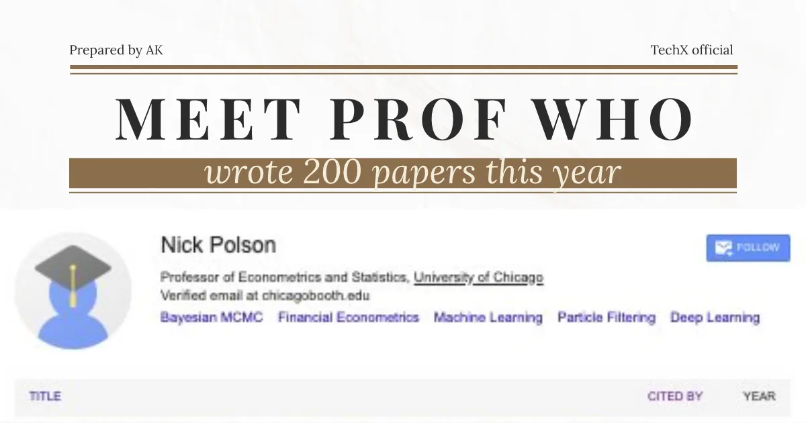{height=300 .absolute top="210" right="0"}

::::aside

From [Ship X/ TechX on medium](https://medium.com/techx-official/meet-a-professor-who-wrote-200-papers-this-year-using-ai-792cb4377154)

::::

## AI has uses

peer review

ethics

# Good reforms go bad{background-image='figures/joe-dudeck-lt4Pb2vhkyw-unsplash.jpg' background-opacity=0.8 background-size='cover' visibility="uncounted"}

<!-- instead of aside -->
       

Photo by <a href="https://unsplash.com/@joetography?utm_source=unsplash&utm_medium=referral&utm_content=creditCopyText">Joe Dudeck</a> on <a href="https://unsplash.com/photos/an-old-rusty-train-car-sitting-in-a-field-lt4Pb2vhkyw?utm_source=unsplash&utm_medium=referral&utm_content=creditCopyText">Unsplash</a>

## 1) Data sharing

* A good reform that has been underused

* Allows others to validate your work

* Allows others to run new analyses

* Helps spot research fraud

## Open data mining{background-color='white'}

::: aside

DOI:
[10.1016/j.jclinepi.2026.112203](https://www.sciencedirect.com/science/article/pii/S0895435626000788)

:::

## OpenSafely{background-color='white'}

:::: columns
::: {.column width="50%"}
* Keeps data safe

* Allow more analysis

* Solves many ethical concerns

* Keep the machines at arms length
:::
  
::: {.column width="50%"}
{.absolute top="1" right="1" width=320}
:::
::::

::::aside

[opensafely.org](https://www.opensafely.org/); Bennett Institute, University of Oxford, and NHS England; Photo by <a href="https://unsplash.com/@cantt?utm_source=unsplash&utm_medium=referral&utm_content=creditCopyText">cant</a> on <a href="https://unsplash.com/photos/white-clouds-hovering-above-grey-castle-Ipv_MNTzcQI?utm_source=unsplash&utm_medium=referral&utm_content=creditCopyText">Unsplash</a>

::::

## 2) Ethics

## Attempted census of Australian ethics committees

People without statistical qualifications

::::aside
DOI: [10.1162/QSS.a.479](https://direct.mit.edu/qss/article/doi/10.1162/QSS.a.479/136239/The-varying-perceptions-of-a-statistician-s-value) with Nicole White and Taya Collyer
::::

## Transparency

* Every Australian Human Research Ethics Committees needs to publicly state if they examine the study design or not

* Need a national public registry of cleared projects

## {background-color='white'}

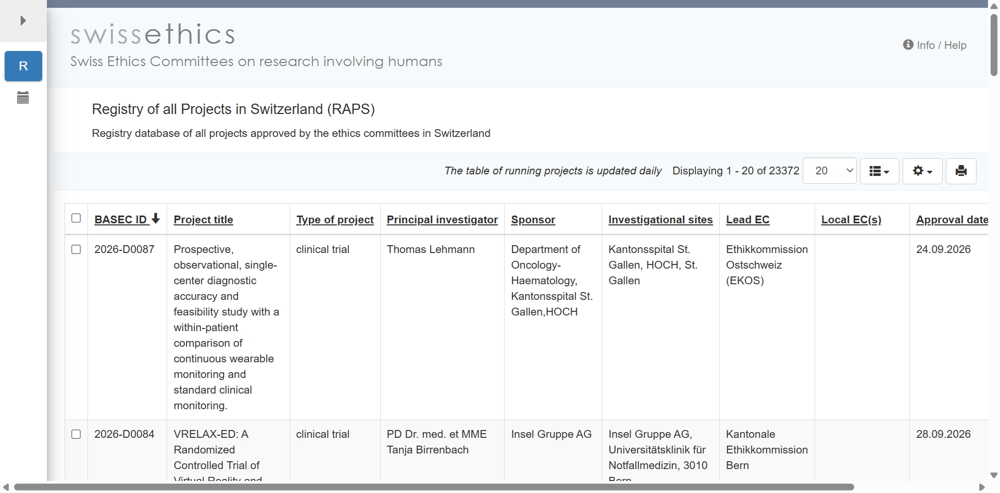

:::: aside
[Registry of all Projects in Switzerland](https://raps.swissethics.ch/runningProjects_list.php?orderby=dBASECID)
::::

## 3) Shiny

* Allows easy translation of statistical tools 

* Removed barrier of needing html programming skills

## {background-color='white'}

#### Personalised survival predictions

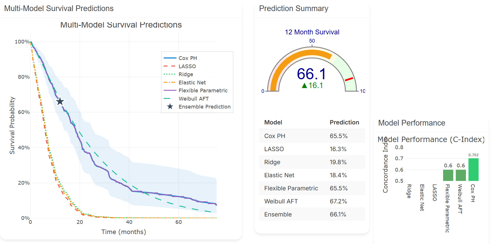{width=980}

::::aside
[from shiny](https://panacea.shinyapps.io/Mesothelioma/)
::::

# Prediction models{background-image='figures/immo-wegmann-DX3_dXuHVl8-unsplash.jpg' background-opacity=0.4 background-size='cover'}

<!-- instead of aside -->
      

Photo by <a href="https://unsplash.com/@tinkerman?utm_source=unsplash&utm_medium=referral&utm_content=creditCopyText">Immo Wegmann</a> on <a href="https://unsplash.com/photos/brown-and-black-round-board-DX3_dXuHVl8?utm_source=unsplash&utm_medium=referral&utm_content=creditCopyText">Unsplash</a>

## Hacking

<!--- from Alex, T:\CLGEUS2171\02_auc_hacking\cpm_auc\03_figures --->

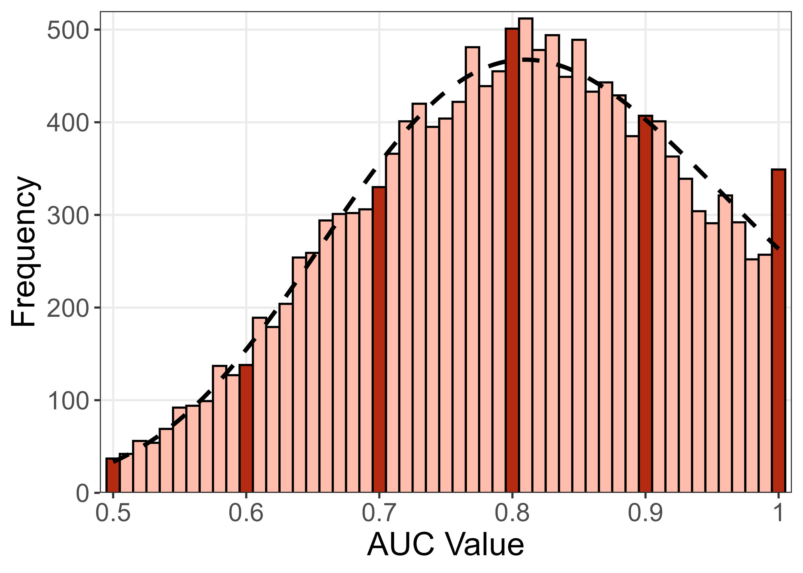

::::aside
Alex's DOI to come
::::

## Routes to goals{background-color='white'}

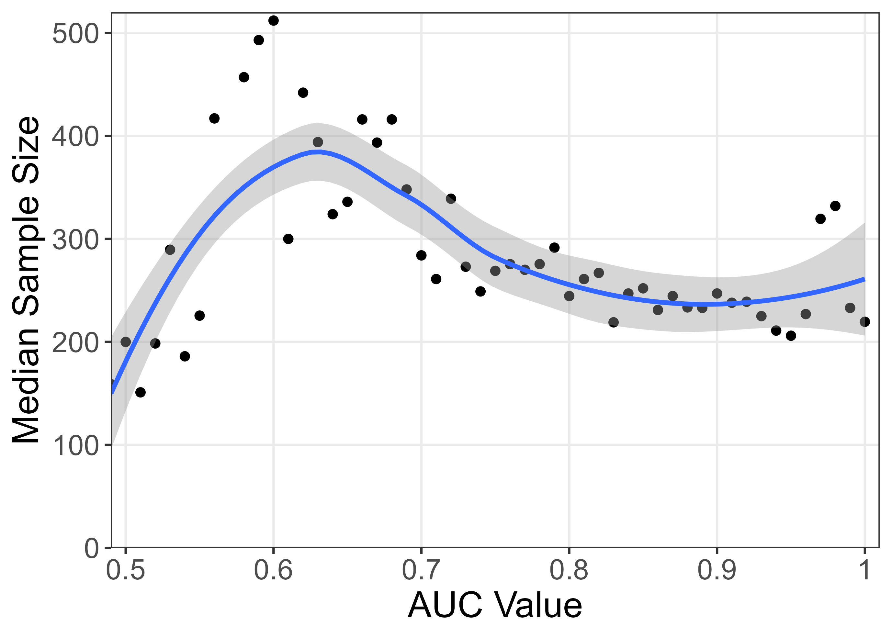

## The temptation of perfection

TO DO, split over slides

* 0.90 to 1.0 looks like a small difference

* No pills work in everybody

* We rarely say we are 'curing diseases' with drugs/interventions, we usually say 'treating'

* Is 'predicting disease' the problem? Do we need a new phrase?

## Changing treatment{background-color='white'}

<!--- Bayesian Additive Regression Trees for treatment effect heterogeneity; also subgroup analysis --->

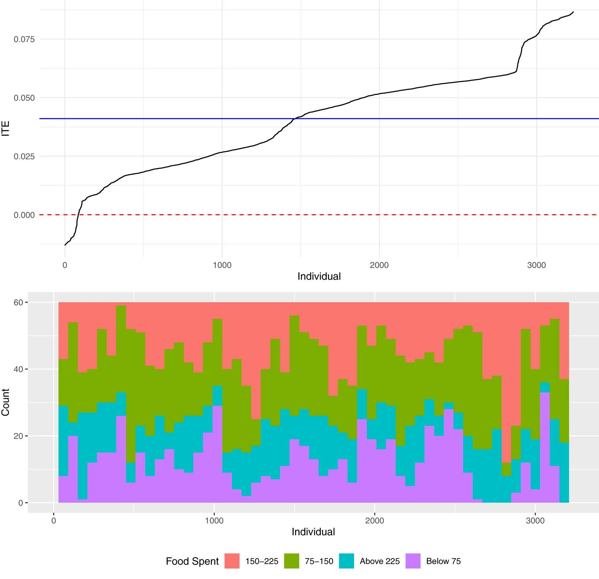{width = 500}

::::aside

DOI: [10.1038/s41591-023-02670-4](https://www.nature.com/articles/s41591-023-02670-4)

::::

<!--- pinch of salt that would make you wince --->

# AI{background-image='figures/melanie-wasser-j8a-TEakg78-unsplash.jpg' background-opacity=0.4 background-size='cover'}

<!-- instead of aside -->
       

Photo by <a href="https://unsplash.com/@melwasser?utm_source=unsplash&utm_medium=referral&utm_content=creditCopyText">Melanie Wasser</a> on <a href="https://unsplash.com/photos/woman-holding-her-face-in-dark-room-j8a-TEakg78?utm_source=unsplash&utm_medium=referral&utm_content=creditCopyText">Unsplash</a>

## AI making too much (part 1){background-color='white'}

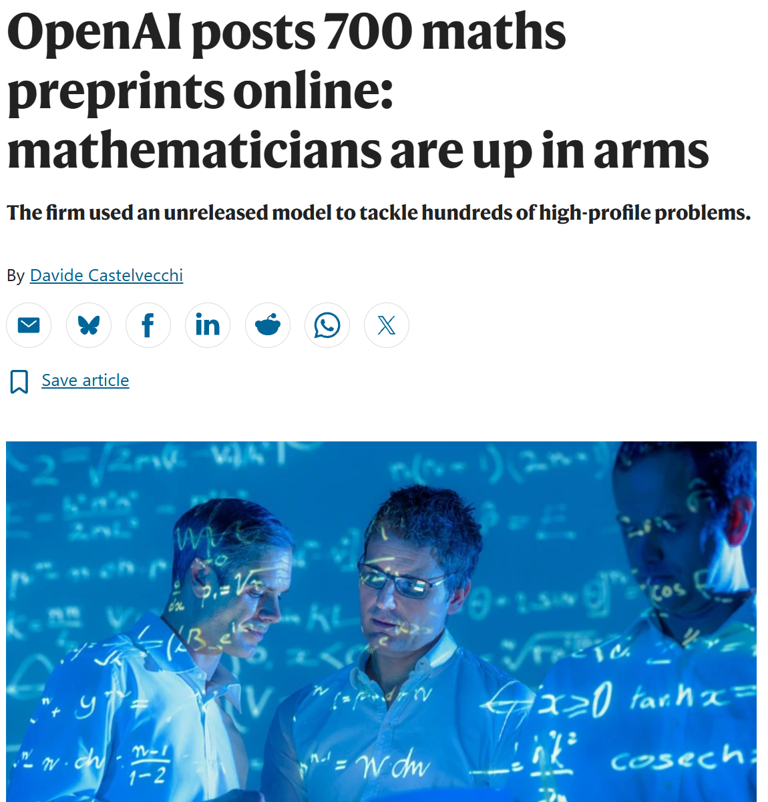{height=500}

::::aside

DOI: [10.1038/d41586-026-03196-8](https://www.nature.com/articles/d41586-026-03196-8)

::::

## AI making too much (part 2){background-color='white'}

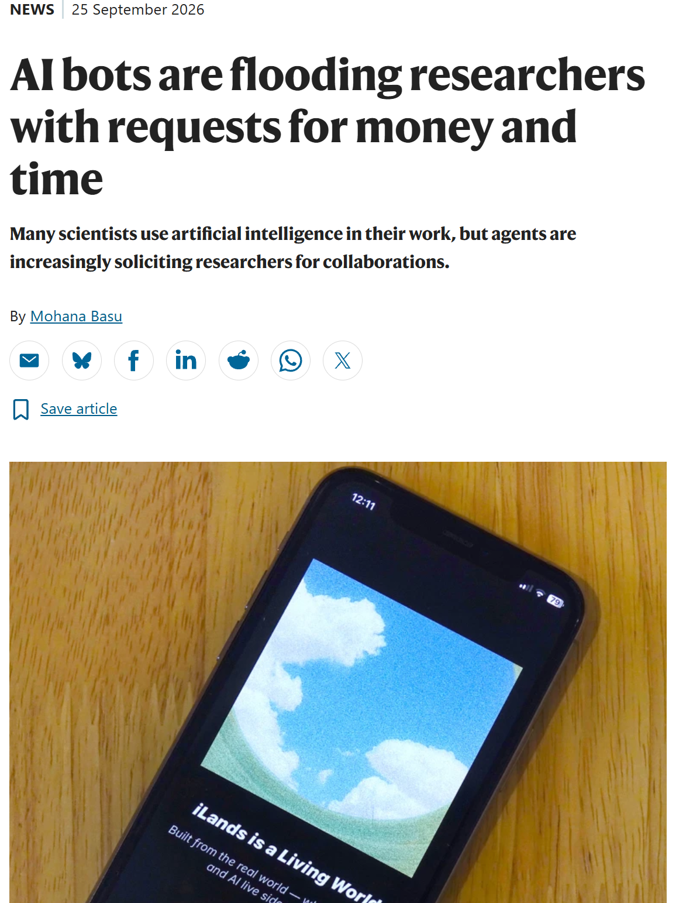{height=500}

::::aside

DOI: [10.1038/d41586-026-03005-2](https://www.nature.com/articles/d41586-026-03005-2)

::::

<!--- No time for me to comment --->

##

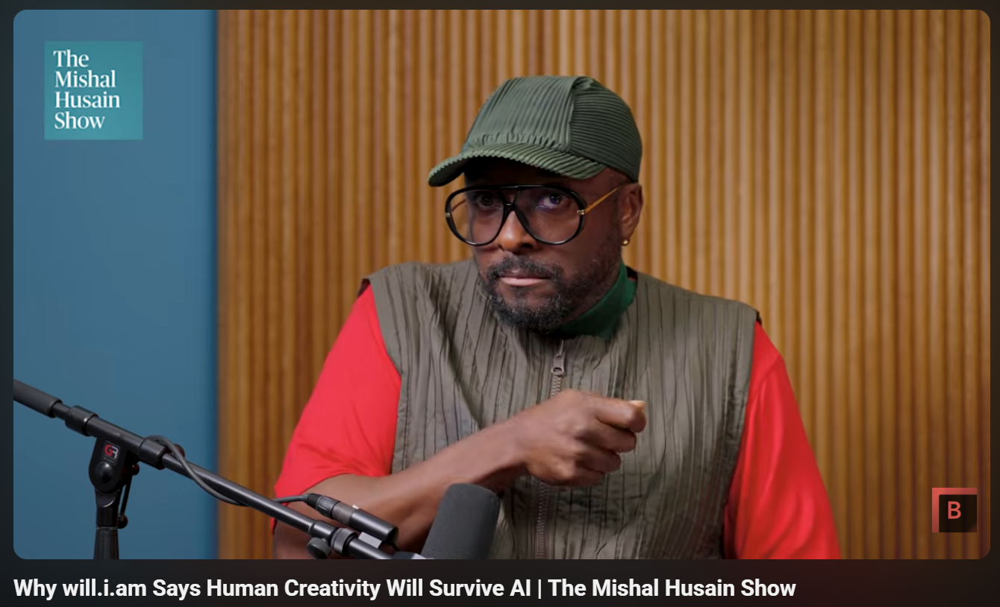{height=400}

``Need a lived experience file'', Will.i.am

::::aside
[will.i.am talking on the Mishal Husian show](https://www.youtube.com/watch?v=crP2r9BmRPs)
::::

## Predict the next word

<!--- can't capture in in-jokes from living in the UK in the 1980s --->

:::: columns
::: {.column width="40%"}
Julian Barnes
:::
  
::: {.column width="60%"}
{width=400}
:::
::::

::::aside
[CC BY-SA 4.0](https://commons.wikimedia.org/w/index.php?curid=81934217) By WanderingTrad - Own work, 
::::

<!--- chops off edges, Julian Barnes --->

## Predict the next pixel{background-color='white'}

:::: columns
::: {.column width="50%"}
AI

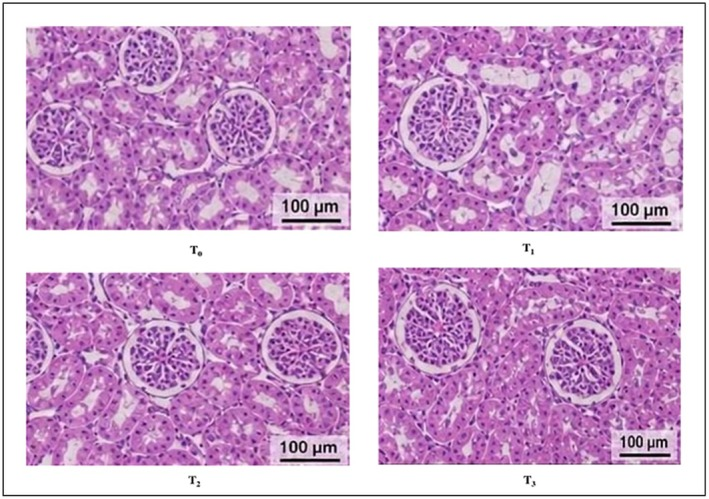{width=450}
:::
  
::: {.column width="50%"}
Real

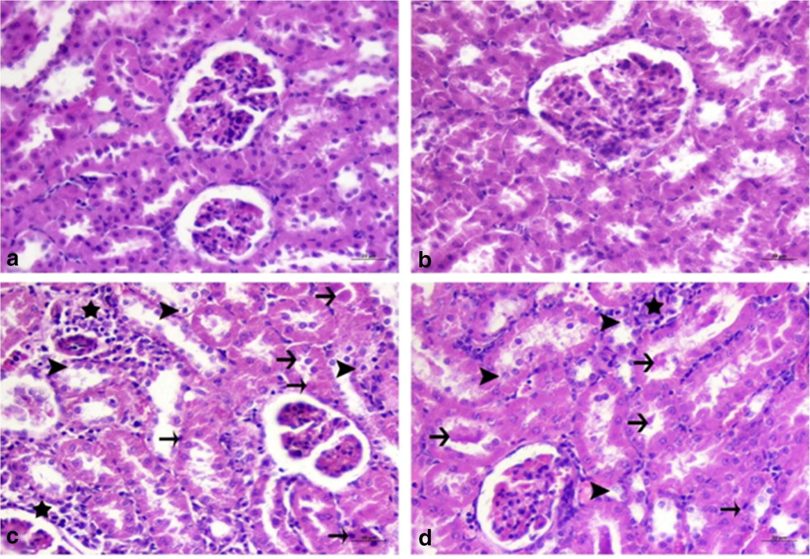{width=450}
:::
::::

::::aside

Hat tip to [Sholto David](https://www.youtube.com/watch?v=G9KHwXNIJyk&t=318s); [Image 1](https://pmc.ncbi.nlm.nih.gov/articles/PMC13332335/figure/fsn372068-fig-0010/); [Image 2](https://link.springer.com/article/10.1007/s12011-020-02268-8/figures/5)

::::

## Bonkers stuff

::::aside
Thanks to [Peer-Reviewed Slop](https://bsky.app/profile/peer-reviewed-slop.bsky.social); paper in [Elsevier journal](https://www.sciencedirect.com/science/article/abs/pii/S0010854524002881)
::::

## Shift the AUC distribution?

# Fraud

## BMJ

## Kaggle

## Upper limit on publication counts

Are you real?

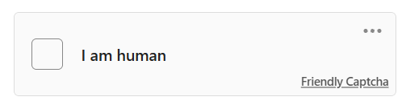

* Magazine that now only [takes pitches by phone](https://www.niemanlab.org/2026/08/facing-a-deluge-from-ai-this-publication-will-only-take-pitches-by-phone/) after a deluge of AI stories

## Why are we here?{background-image='figures/childrens_hospital.jpg' background-opacity=0.9 background-size='cover'}

## Questions and comments

<iframe src="https://giphy.com/embed/1hMjHC64mp26EKQbDK" width="490" height="490" style="" frameBorder="0" class="giphy-embed" allowFullScreen></iframe>

::::aside

<a href="https://giphy.com/gifs/loop-trippy-psychedelic-1hMjHC64mp26EKQbDK">via GIPHY</a>

::::

# what was the other thing you thought about during sleep?